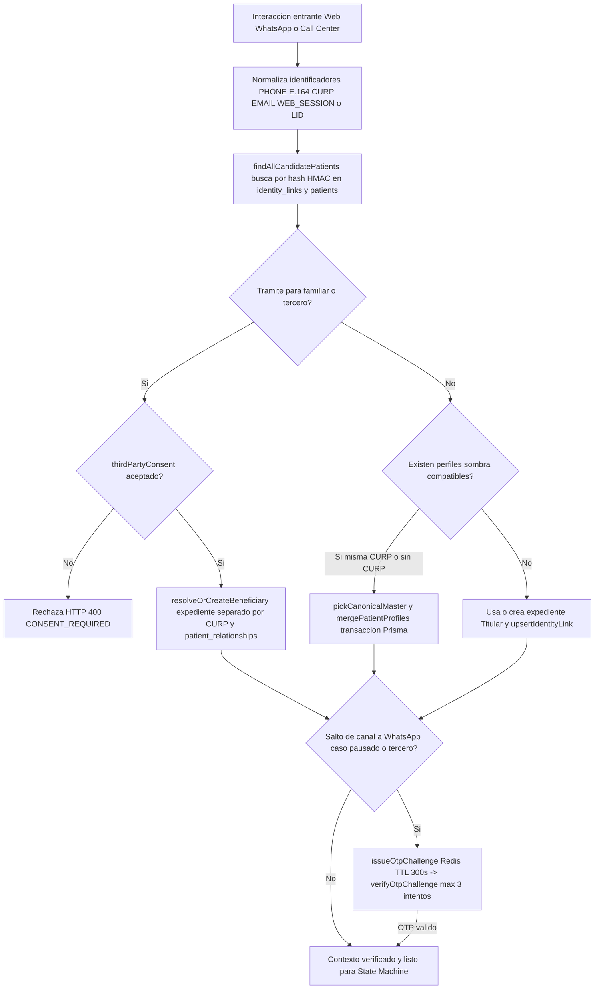
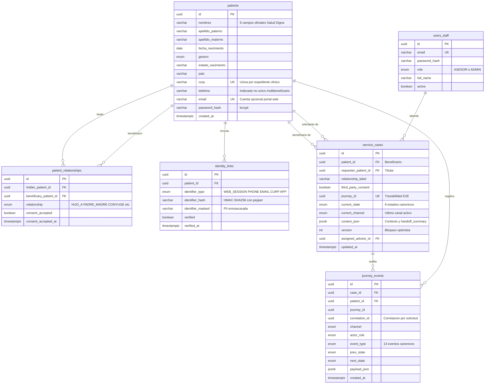
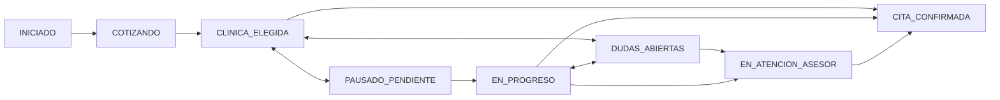
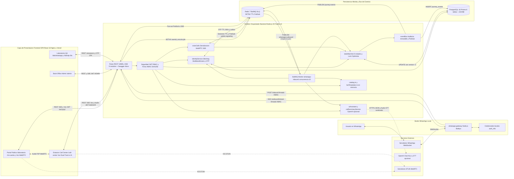
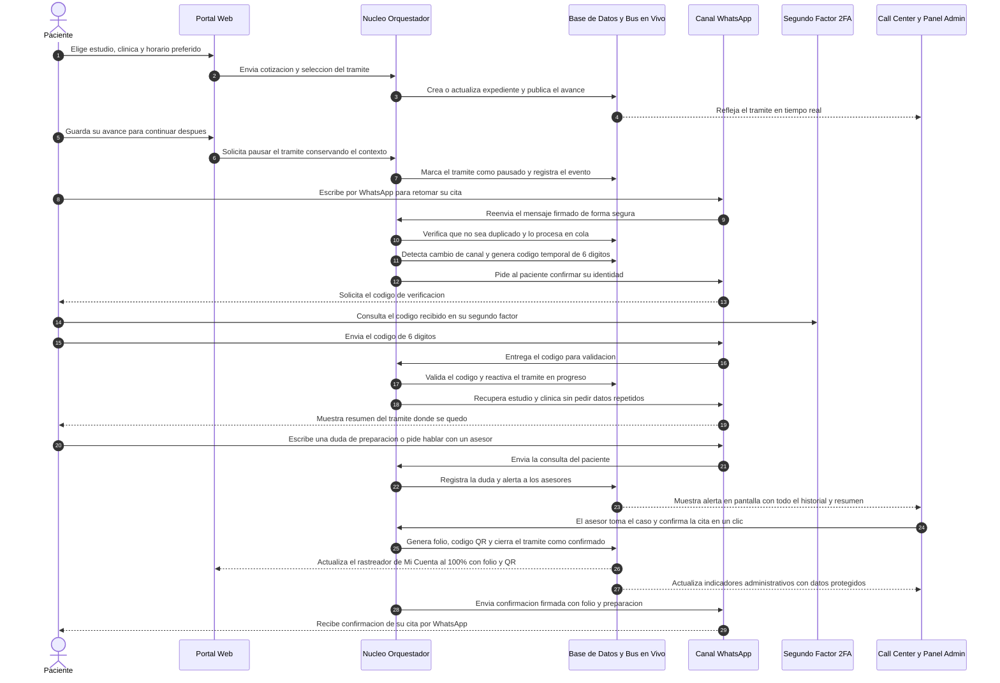

# Documentación de Arquitectura y Prototipo — Reto Salud Digna Omnicanal (Beta v2)

> **Principio rector:** *"Un paciente, una sola conversación"*  
> Documento técnico basado en la implementación real del repositorio (`frontend/`, `backend/`, `whatsapp-gateway/`, `backend/prisma/` y `docker-compose.yml`).

---

## Estrategia y resolución

La resolución de identidad (*Identity Resolution & Stitching*) unifica las interacciones dispersas de un mismo paciente en Sitio Web, WhatsApp y Call Center bajo un expediente canónico, **sin mezclar nunca expedientes clínicos de familiares o terceros** que compartan teléfono (cumplimiento de privacidad clínica LFPDPPP).

### Pilares implementados en código (`backend/src/core/identityService.ts`)

1. **Identificadores normalizados y protegidos con HMAC-SHA256:**
   - Todos los identificadores (`WEB_SESSION`, `PHONE`, `EMAIL`, `CURP`, `APP` para `@lid` de WhatsApp con formato `LID:<digitos>`) se normalizan (teléfono a E.164 México `+52...`, CURP en mayúsculas) y se indexan en `identity_links` mediante `HMAC-SHA256(PII_HASH_PEPPER, valor)` junto a una versión enmascarada (`identifier_masked`) para observabilidad.
2. **Separación Multibeneficiario (`Titular != Beneficiario`):**
   - `patients.telefono` **no es único**, permitiendo que un titular gestione citas para hijos, padres, cónyuge u otros familiares.
   - Cada beneficiario conserva su propio registro en `patients`, indexado por su propia `CURP` única en `identity_links`, y vinculado al titular en `patient_relationships` con registro de consentimiento (`consent_accepted`, `consent_accepted_at`).
   - En `service_cases`, `patient_id` apunta al **Beneficiario** y `requester_patient_id` apunta al **Titular** que tramita la cita.
3. **Smart Identity Stitching & Merge (`mergePatientProfiles`):**
   - Al registrarse, iniciar sesión o consultar `/api/patients/me`, `reconcilePatientOmnichannelHistory` detecta expedientes sombra creados previamente en WhatsApp, Call Center o sesión web invitada y los fusiona en una transacción Prisma (`$transaction`) hacia el expediente maestro (`pickCanonicalMaster`: prioridad cuenta con `passwordHash` -> tiene `curp` -> más antiguo).
   - La guarda `canSafelyMergePatients` **prohíbe fusionar** dos perfiles con CURP distinta o dos cuentas con contraseña propia.
4. **Verificación Step-Up OTP Out-of-Band:**
   - Al retomar un trámite en WhatsApp proveniente de otro canal, pausado (`PAUSADO_PENDIENTE`) o perteneciente a un tercero, o al vincular un teléfono/folio secundario desde `Mi Cuenta`, se exige un código OTP de 6 dígitos almacenado en Redis (`TTL 300s`, máx. `3` intentos, hash HMAC) y entregado fuera de banda (simulado en Consola 2FA `/lab/otp-2fa` vía `/api/otp-2fa/inbox`).

### Diagrama de flujo — Estrategia de resolución de identidad y seguridad

---

## Modelo de persistencia y contexto

El sistema utiliza una **persistencia híbrida** diseñada para mantener los nodos de API completamente *stateless*:

- **PostgreSQL 16 (Prisma ORM — `backend/prisma/schema.prisma`):** almacena datos maestros, estado canónico del trámite, contexto acumulado (`JSONB`) y pista de auditoría inmutable en 6 tablas.
- **Redis 7 (AOF + `maxmemory-policy noeviction` — `backend/src/lib/redis.ts`):** gestiona colas BullMQ (`whatsapp-inbound`, `whatsapp-dlq` con `prefix: "{bull}"`), idempotencia atómica `SETNX` (`wamid:<id>`, TTL 24h), retos OTP (TTL 5m), selección multibeneficiario en WhatsApp (`wa:active_case:<phone>`, TTL 30m), historial de chat (`sim:wa:chat:<phone>`, TTL 24h), buffer de reconexión del gateway (`gw:wa:outbound:pending`, TTL 30m), sesiones de llamada WebRTC (`webrtc:call:<callId>` y set `webrtc:calls:ringing`, TTL 1h) y canales Pub/Sub (`journey:events`, `whatsapp:outbound` y `webrtc:signaling`).
- **Contexto acumulado (`service_cases.context_json`):** objeto `JSONB` tipado (`CaseContextJson` en `backend/src/core/stateMachine.ts`) que conserva `study`, `clinic`, `preferred_slot`, `payment_method`, `open_questions`, `call_summaries` (hasta 15 registros `CallSummaryRecord` con resumen, `patientSafeSummary`, acuerdos, pendientes, sentimiento y entidades extraídas), `latest_call_summary`, `appointment_folio`, `qr_payload`, `otp_verified_channels`, `beneficiary_summary` y el resumen determinístico `handoff_summary`.
- **Bloqueo optimista (`service_cases.version`):** cada transición actualiza únicamente si `WHERE id = ? AND version = expectedVersion`, incrementando `version + 1` o devolviendo `HTTP 409 OPTIMISTIC_LOCK_CONFLICT` ante escrituras concurrentes.
- **Borrador local en navegador (`frontend/src/lib/bookingContext.ts`):** `localStorage` (`sd_omnicanal_booking_drafts_v1`) guarda el avance exacto del wizard de 3 pasos por `caseId` para complementar la rehidratación en Web y Call Center.

### Modelo Entidad-Relación (PostgreSQL 16)

---

## Catálogo de eventos

Cada transición o hito relevante se escribe de forma inmutable en `journey_events` (`backend/src/core/eventBus.ts` -> `recordAndPublishEvent`) con `journey_id` (identificador único del viaje) y `correlation_id` (UUID por operación), y se difunde de inmediato al bus Redis Pub/Sub `journey:events` con el nombre del paciente enmascarado (`patientMasked`).

### Los 13 eventos oficiales (`enum EventType` en `backend/prisma/schema.prisma`)

| # | Evento (`EventType`) | Emisor(es) reales en código | Estado destino típico | Propósito en trazabilidad |
| --- | --- | --- | --- | --- |
| 1 | `SESSION_STARTED` | `webChannel.ts`, `whatsappQueue.ts`, `aiAssistant.ts` | `INICIADO` | Marca el inicio de un nuevo trámite y registra canal de origen y bandera `isThirdParty`. |
| 2 | `IDENTITY_LINKED` | `webChannel.ts`, `identityService.ts`, `aiAssistant.ts` | Sin cambio | Registra vinculación de teléfono/CURP/correo o fusión inteligente (`smartMerge`). |
| 3 | `STUDY_QUOTED` | `webChannel.ts`, `whatsappQueue.ts`, `aiAssistant.ts` | `COTIZANDO` | Guarda el estudio seleccionado del catálogo oficial (`studyCode`, `price`, `prep`). |
| 4 | `CLINIC_SELECTED` | `webChannel.ts`, `whatsappQueue.ts`, `aiAssistant.ts` | `CLINICA_ELEGIDA` | Guarda la clínica oficial y/o el horario preferido (`preferredDate`, `preferredTime`). |
| 5 | `FLOW_INTERRUPTED` | `webChannel.ts` (`/abandon`), `aiAssistant.ts` | `PAUSADO_PENDIENTE` | Registra pausa o abandono voluntario conservando el contexto intacto como borrador. |
| 6 | `CHANNEL_SWITCH_DETECTED` | `webChannel.ts`, `whatsappQueue.ts` | Sin cambio | Audita el salto entre canales (`fromChannel` -> `toChannel`). |
| 7 | `OTP_CHALLENGE_SENT` | `identityService.ts` (`issueOtpChallenge`) | Sin cambio | Registra emisión del reto Step-Up OTP (`ttlSeconds`, `destinationMasked`). |
| 8 | `OTP_VALIDATION_FAILED` | `identityService.ts` (`verifyOtpChallenge`) | Sin cambio | Audita intentos fallidos, expiración o revocación tras 3 errores (`KPI Admin`). |
| 9 | `IDENTITY_VERIFIED_OTP` | `identityService.ts` (`verifyOtpChallenge`) | Sin cambio | Confirma verificación exitosa del segundo factor y marca `identity_links.PHONE.verified = true`. |
| 10 | `CONTEXT_REHYDRATED` | `webChannel.ts` (`/resume`), `whatsappQueue.ts`, `aiAssistant.ts` | `EN_PROGRESO` | Marca la recuperación exitosa de un flujo pausado o proveniente de otro canal (`KPI Flujos recuperados`). |
| 11 | `PATIENT_QUESTION_LOGGED` | `whatsappQueue.ts`, `aiAssistant.ts` | `DUDAS_ABIERTAS` | Registra una duda clínica/operativa o solicitud explícita de asesor humano (`requestedAdvisor`). |
| 12 | `ADVISOR_ASSIGNED` | `callCenter.ts` (`/assign`) | `EN_ATENCION_ASESOR` | Registra toma del caso por un asesor y dispara Screen-Pop SSE. |
| 13 | `APPOINTMENT_CONFIRMED` | `webChannel.ts`, `whatsappQueue.ts`, `aiAssistant.ts`, `callCenter.ts` | `CITA_CONFIRMADA` | Cierra el trámite generando `folio` (`SD-2026-XXXX`) y `qr_payload`. |

### Estados canónicos del trámite (`CaseState` en `backend/src/core/stateMachine.ts`)

---

## Caso de uso omnicanal a demostrar

El repositorio incluye un escenario demo completo y reproducible usando al paciente semilla **Ana Sofía Morales Ramírez** (`ana@saluddigna.demo` / `+526670000001` / `MORA950412MSLRRN01`, sembrada automáticamente por `backend/prisma/seed.ts`), demostrando **continuidad real en 3 canales con privacidad Step-Up OTP y soporte multibeneficiario**:

### Guion paso a paso del caso de uso

1. **Inicio en Portal Público Web (`/login` -> `/laboratorio`):**
   - Ana inicia sesión (o agenda como invitada) y selecciona el estudio **Ultrasonido Obstétrico** (`US-OBS`, \$320 MXN) y la clínica **Salud Digna Culiacán Centro** (`CLN-CUL-01`) con fecha y horario preferido.
   - Opcionalmente activa **"Agendar para un familiar o conocido"**, acepta el consentimiento de privacidad y captura los datos del beneficiario (generando su CURP y expediente separado).
   - El sistema registra `SESSION_STARTED` -> `STUDY_QUOTED` (`COTIZANDO`) -> `CLINICA_ELEGIDA`.
2. **Interrupción controlada (Pausa en Web):**
   - Ana presiona **"Guardar para continuar después"**, invocando `POST /api/channels/web/abandon`.
   - El caso pasa a `PAUSADO_PENDIENTE` (`FLOW_INTERRUPTED`) sin perder ningún dato.
3. **Salto a Canal WhatsApp (Gateway Baileys real o Simulador `/lab/whatsapp`) + Step-Up OTP 2FA:**
   - Ana escribe desde WhatsApp: *"Hola, quiero continuar con mi estudio"*.
   - El Orquestador detecta el salto de canal (`CHANNEL_SWITCH_DETECTED`) y dispara un reto Step-Up OTP (`OTP_CHALLENGE_SENT`) sin exponer el código en el chat.
   - *(Demostración de seguridad)*: Si se envía un código erróneo (`000000`), el sistema lo bloquea y audita `OTP_VALIDATION_FAILED`.
   - Al consultar el código real en la **Consola 2FA externa** (`/lab/otp-2fa`) y enviarlo por WhatsApp, el sistema audita `IDENTITY_VERIFIED_OTP` y `CONTEXT_REHYDRATED` (`EN_PROGRESO`), rehidratando exactamente el estudio y clínica elegidos en Web.
   - *(Multibeneficiario)*: Si Ana tiene más de un trámite abierto (propio y de un familiar), WhatsApp despliega un menú numerado con nombres enmascarados para elegir qué trámite retomar.
4. **Duda clínica / Escalamiento en WhatsApp:**
   - Ana pregunta *"¿Necesito ir en ayuno?"* o solicita un asesor de Call Center.
   - El sistema registra la duda (`PATIENT_QUESTION_LOGGED` -> `DUDAS_ABIERTAS`) y responde con la preparación oficial del estudio (`STUDIES_CATALOG`).
5. **Salto a Call Center (`/call-center`) con Llamada WebRTC en vivo, Resumen IA y Confirmación en 1 clic:**
   - En la estación del asesor (`asesor@saluddigna.demo`), el stream SSE dispara un **Screen-Pop en vivo** con el `handoff_summary`, estudio, clínica, horario y duda pendiente de Ana, sin pedirle repetir datos.
   - *(Integración de Voz WebRTC + Resumen IA)*: Ana también puede pulsar **"Llamar a un asesor"** desde `/laboratorio` o `/mi-cuenta` (`PatientVoiceCallBar.tsx`). El asesor recibe la alerta `incoming_call` en `AdvisorVoicePanel.tsx`, contesta en audio P2P WebRTC (asignando el caso automáticamente a `EN_ATENCION_ASESOR`), graba ambas pistas con `DualTrackAudioRecorder` y al colgar procesa el audio con `POST /api/call-center/cases/:caseId/calls/process` (OpenAI STT `gpt-4o-mini-transcribe` / fallback `whisper-1` + resumen estructurado sanitizado + aplicación en 1 clic de entidades detectadas). El resumen se sincroniza automáticamente con Call Center, el bot de WhatsApp (`aiAssistant.ts`) y `Mi Cuenta`.
   - El asesor asigna el caso (`ADVISOR_ASSIGNED` -> `EN_ATENCION_ASESOR`) y confirma la cita en 1 clic (`APPOINTMENT_CONFIRMED` -> `CITA_CONFIRMADA`), generando Folio (`SD-2026-XXXX`) + QR y disparando una notificación firmada HMAC-SHA256 hacia WhatsApp.
6. **Validación en Tiempo Real (`Mi Cuenta` y `/admin`):**
   - En `/mi-cuenta`, Ana observa el tracker tipo envío avanzar a **Cita confirmada (100%)** con su Folio y QR al instante vía SSE.
   - En `/admin` (`admin@saluddigna.demo`), el tablero actualiza KPIs, distribución por estado/canal, métricas BullMQ/DLQ y línea de tiempo correlacionada con **PII enmascarada**.

### Diagrama de flujo del caso de uso omnicanal

```mermaid
flowchart LR
    S1["1. Web: Ana cotiza US-OBS y elige CLN-CUL-01"]
    S2["2. Web: Pausa borrador PAUSADO_PENDIENTE"]
    S3["3. WhatsApp: Salto de canal y reto Step-Up OTP"]
    S4["4. Consola 2FA: Valida OTP y rehidrata EN_PROGRESO"]
    S5["5. WhatsApp: Duda de ayuno DUDAS_ABIERTAS"]
    S6["6. Call Center: Screen-Pop SSE y asignacion"]
    S7["7. Call Center: Confirma Folio + QR CITA_CONFIRMADA"]
    S8["8. Sync vivo: Aviso WhatsApp + Mi Cuenta + Admin"]

    S1 -->|STUDY_QUOTED y CLINIC_SELECTED| S2
    S2 -->|FLOW_INTERRUPTED| S3
    S3 -->|OTP_CHALLENGE_SENT| S4
    S4 -->|CONTEXT_REHYDRATED| S5
    S5 -->|PATIENT_QUESTION_LOGGED| S6
    S6 -->|ADVISOR_ASSIGNED| S7
    S7 -->|APPOINTMENT_CONFIRMED| S8
```

---

## FASE II. INFORMACIÓN DEL PROTOTIPO

### PLATAFORMA Y PROTOTIPO DE TRAZABILIDAD OMNICANAL

El prototipo está construido como una plataforma web y de mensajería modular organizada en **4 entornos aislados de interfaz** (`frontend/src/App.tsx`), un **Cerebro Orquestador stateless** (`backend/`) y un **Gateway local WhatsApp** (`whatsapp-gateway/`), desplegable con Docker Compose (`docker-compose.yml`) o apuntando al entorno en vivo de AWS (`us-east-2`).

---

#### Continuidad entre canales

La continuidad bidireccional (*N-saltos* entre Web, WhatsApp y Call Center) se garantiza mediante cuatro mecanismos técnicos activos en el prototipo:

1. **Estado único centralizado por `journey_id`:** Ningún canal guarda la verdad del trámite de forma aislada; todos leen y mutan `service_cases` (estado canónico + `context_json`) a través de `transitionServiceCase`.
2. **Reanudación exacta del paso del wizard (`inferResumeStep`):**
   - Desde `/mi-cuenta`, el botón **"Retomar solicitud aquí"** llama a `POST /api/channels/web/cases/:caseId/resume` (`CHANNEL_SWITCH_DETECTED` + `CONTEXT_REHYDRATED`) y abre `/laboratorio?resumeCaseId=<id>` posicionando al paciente en el Paso 1, 2 o 3 según lo ya completado en WhatsApp, Web o Call Center.
   - En `CallCenterPage.tsx`, al abrir un caso de la bandeja, el asesor visualiza exactamente el mismo flujo de 3 pasos pre-hidratado con lo capturado en otros canales.
3. **Motor Dual de WhatsApp con NLU opcional y fallback determinístico:**
   - Tanto el **Gateway Baileys local** (`POST /api/gateways/whatsapp/inbound` -> BullMQ) como el **Simulador QA** (`POST /api/channels/whatsapp/simulate`) comparten el mismo motor `processWhatsAppInbound` e idempotencia atómica `SETNX` (`wamid:<id>`).
   - Si `OPENAI_API_KEY` está configurada, `aiAssistant.ts` habilita 12 *tools* (Function Calling) estrictamente subordinadas a `stateMachine.ts` y `identityService.ts` con sanitización PII previa (`scrubPotentialPii`); si no hay clave o hay error/timeout (`6.5s`), cae de forma invisible al motor 100% determinístico (`BOT_TEMPLATES`).
4. **Protección ante concurrencia simultánea:**
   - El campo `service_cases.version` impide sobrescrituras silenciosas si dos canales intentan mutar el mismo trámite al mismo tiempo (`HTTP 409 OPTIMISTIC_LOCK_CONFLICT`, validado en `backend/src/scripts/testReliability.ts`).
5. **Voz WebRTC en tiempo real y continuidad post-llamada (`voiceCalls.ts` + `callSummaryService.ts`):**
   - El paciente puede iniciar llamadas de voz P2P directamente desde `/laboratorio` o `/mi-cuenta` conservando el `caseId` activo (`PatientVoiceCallBar.tsx`), con señalización stateless sobre Redis Pub/Sub `webrtc:signaling`.
   - Al colgar, `AdvisorVoicePanel.tsx` envía la grabación dual-track (o respaldo por archivo/texto) a `POST /api/call-center/cases/:caseId/calls/process`; el resumen estructurado y los acuerdos quedan en `context_json.call_summaries` y se inyectan tanto en `handoff_summary` como en el prompt/contexto del bot de WhatsApp (`aiAssistant.ts`), permitiendo aplicar estudio/clínica/horario/pago detectados con `POST /api/call-center/cases/:caseId/calls/:summaryId/apply`.

---

#### Visibilidad del patient Journey

El prototipo ofrece trazabilidad en vivo orientada a dos audiencias distintas, ambas alimentadas por **Server-Sent Events (SSE)** sobre **Redis Pub/Sub (`journey:events`)**:

1. **Visibilidad para el Paciente (`/mi-cuenta` — `PatientAccountPage.tsx` y `OrderJourneyTracker.tsx`):**
   - Suscripción SSE privada a `GET /api/patients/me/stream` con filtrado estricto en servidor (`patientId` o `requesterPatientId` igual al usuario autenticado).
   - Componente visual **estilo seguimiento de envío (6 etapas: 01 Solicitud iniciada -> 06 Cita confirmada)** con barra de progreso, contador de canales recorridos, historial cronológico desplegable de eventos (incluyendo `patientSafeSummary` de cada llamada atendida en Call Center), barra de llamada WebRTC (`PatientVoiceCallBar.tsx`) y tarjeta final con Folio y QR.
   - En citas gestionadas para familiares, muestra aviso de privacidad clínica y enmascara el nombre del beneficiario.
   - Incluye herramienta de **vinculación asistida por OTP** (`/api/patients/me/link-channel/request` y `/verify`) para absorber citas hechas con otro teléfono o folio.
2. **Visibilidad Administrativa y Operativa (`/admin` — `AdminDashboard.tsx` y `BusArchitectureView.tsx`):**
   - Consola aislada con 3 pestañas conectadas al stream `GET /api/stream/events`:
     - **Estadísticas del servicio:** 6 KPIs en vivo (Casos totales, Citas confirmadas y % conversión, Flujos recuperados `CONTEXT_REHYDRATED`, OTP fallidos auditados, Eventos registrados y Clientes SSE), distribución por estado canónico y por canal, salud de PostgreSQL/Redis, contadores en tiempo real de colas BullMQ (`whatsapp-inbound` y `whatsapp-dlq`), tabla de casos con **PII estrictamente enmascarada** y feed de eventos en vivo.
     - **Consultar usuario:** búsqueda por teléfono, CURP, correo, nombre o `journey_id`/`case_id` (`GET /api/admin/users/lookup`), desplegando el tracker visual y la auditoría con `actorRole` y `correlation_id`.
     - **Arquitectura y bus de datos en tiempo real:** vista interactiva (`BusArchitectureView.tsx`) que ilumina los módulos recorridos por el último evento en el bus y reporta gateways Baileys activos (`GET /api/gateways/whatsapp/status`).

---

#### Gestión de roles

El control de acceso combina **JWT segregado por ámbito (`scope`)** en `backend/src/lib/crypto.ts` + `backend/src/middleware/rbac.ts`, **firma criptográfica HMAC-SHA256** para el Gateway WhatsApp y **aislamiento visual de sesiones** en `frontend/src/lib/api.ts` (claves `localStorage` separadas por rol para operar Admin, Call Center y Paciente en paralelo).

| Rol / Actor | Mecanismo de autenticación | Rutas Frontend | Endpoints Backend autorizados | Nivel de acceso a PII | Credencial demo (`seed.ts`) |
| --- | --- | --- | --- | --- | --- |
| **Paciente (Invitado / Registrado)** | Invitado en flujo web; JWT `scope: "PATIENT"` (7 días) para cuenta | `/`, `/login`, `/registro`, `/laboratorio`, `/mi-cuenta`, `/privacy` | `/api/catalog`, `/api/channels/web/*`, `/api/patients/auth/*`, `/api/patients/me`, `/api/patients/me/stream`, `/api/patients/me/link-channel/*`, `/api/voice/calls`, `/api/voice/stream/patient/:callId`, `/api/voice/calls/:callId/ice`, `/end` | Acceso completo a su propio perfil y folios; vista operativa limitada para terceros; `patientSafeSummary` de llamadas | Registro libre o `ana@saluddigna.demo` / `Paciente2026!` |
| **Asesor Call Center (`ASESOR`)** | JWT `scope: "STAFF"`, `role: "ASESOR"` (12 horas) | `/call-center` | `/api/auth/login`, `/api/call-center/queue`, `/api/call-center/cases/:id/assign`, `/confirm`, `/calls/process`, `/calls/:summaryId/apply`, `/api/voice/stream/advisor`, `/api/voice/calls/:id/answer`, `/api/admin/cases/:id/timeline`, `/api/stream/events` | Acceso operativo al expediente, `handoff_summary`, audio WebRTC y resúmenes IA sanitizados | `asesor@saluddigna.demo` / `Asesor2026!` |
| **Administrador (`ADMIN`)** | JWT `scope: "STAFF"`, `role: "ADMIN"` (12 horas) | `/admin` | Todo lo de `ASESOR` + `/api/admin/overview`, `/api/admin/users/lookup`, `/api/admin/reset-demo` | **PII enmascarada obligatoria** (`patientMasked`, `identifierMasked`) | `admin@saluddigna.demo` / `Admin2026!` |
| **Gateway WhatsApp Local** | Firma HMAC-SHA256 bidireccional (`X-Gateway-Signature` + `X-Gateway-Timestamp`, ventana `300s`) | Proceso CLI `whatsapp-gateway/` | `POST /api/gateways/whatsapp/inbound`, `GET /api/gateways/whatsapp/outbound/stream` | Solo transporte firmado de mensajes del chat | Secreto compartido `WHATSAPP_GATEWAY_SECRET` |
| **Laboratorio QA / 2FA** | Entorno aislado de pruebas (selector `Local / AWS Live`) | `/lab`, `/lab/whatsapp`, `/lab/otp-2fa` | `/api/channels/whatsapp/simulate`, `/history/:phone`, `/api/otp-2fa/inbox`, `/health`, `/docs` | Nombres y destinos enmascarados en bandeja OTP | Sin login (uso QA/demo) |

---

### DIAGRAMAS DE ARQUITECTURA TÉCNICA

#### Arquitectura de solución

El siguiente diagrama representa la arquitectura real implementada en el repositorio, separando los 4 entornos de presentación, el Gateway local Baileys, los módulos internos del Cerebro Orquestador, la capa de persistencia híbrida y los servicios externos.

---

#### Flujo de datos/secuencia

> Los siguientes diagramas están redactados a nivel de **acción operativa y flujo de información** (sin variables ni rutas internas de código) para facilitar su inclusión directa en la memoria técnica y su comprensión por evaluadores funcionales y técnicos.

##### A. Flujo general de datos de extremo a extremo

```mermaid
flowchart LR
    SRC["1. Inicio de interaccion: el paciente o asesor actua desde Sitio Web, WhatsApp o Call Center"]
    VAL["2. Control de seguridad: valida permisos de usuario, firma digital y formato de la solicitud"]
    DEC_CH{"Proviene de WhatsApp?"}
    IDEMP["3. Prevencion de duplicados: verifica que el mensaje no haya sido procesado antes"]
    QUEUE["4. Procesamiento asincrono: encola el mensaje con reintentos automaticos ante fallos"]
    ID_RES["5. Resolucion de identidad: identifica al titular, separa expedientes familiares y solicita codigo de verificacion si hubo cambio de canal"]
    LOGIC["6. Orquestacion del tramite: valida el paso actual, aplica reglas del catalogo oficial y apoya con IA opcional"]
    DB["7. Guardado seguro: actualiza el tramite protegiendo contra cambios simultaneos y registra el movimiento en el historial"]
    BUS["8. Distribucion en tiempo real: publica el cambio en el bus de eventos"]
    OUT["9. Actualizacion en vivo: refresca Mi Cuenta, la pantalla del asesor, el panel administrativo y envia aviso por WhatsApp"]

    SRC --> VAL
    VAL --> DEC_CH
    DEC_CH -->|Si| IDEMP
    IDEMP --> QUEUE
    QUEUE --> ID_RES
    DEC_CH -->|No| ID_RES
    ID_RES --> LOGIC
    LOGIC --> DB
    DB --> BUS
    BUS --> OUT
```

##### B. Diagrama de secuencia — Viaje omnicanal completo del paciente

##### C. Flujo de llamada de voz en vivo y resumen inteligente en Call Center

```mermaid
flowchart LR
    L1["1. El paciente solicita hablar con un asesor desde el Portal Web conservando su tramite activo"]
    L2["2. El sistema notifica la llamada entrante en tiempo real a los asesores disponibles"]
    L3["3. El asesor contesta la llamada y el expediente se asigna automaticamente a su estacion"]
    L4["4. Se establece comunicacion de voz directa entre paciente y asesor mientras se graban ambas voces"]
    L5["5. Al finalizar la llamada, el audio se envia para transcripcion automatica o mediante respaldo de archivo y texto"]
    L6["6. Se protegen datos sensibles de la transcripcion como CURP, tarjetas y codigos temporales"]
    L7["7. Se genera un resumen estructurado con acuerdos, pendientes, sentimiento y datos de cita detectados"]
    L8["8. El asesor revisa y aplica los cambios sugeridos al tramite si corresponde"]
    L9["9. El resumen queda sincronizado en Call Center, en el asistente de WhatsApp y en Mi Cuenta del paciente"]

    L1 --> L2
    L2 --> L3
    L3 --> L4
    L4 --> L5
    L5 --> L6
    L6 --> L7
    L7 --> L8
    L8 --> L9
```

---

## Validación técnica y confiabilidad (Evidencia de pruebas)

El script automatizado `backend/src/scripts/testReliability.ts` (`npm run test:reliability`) verifica 5 controles de ingeniería contra la API activa:

1. **Seguridad HMAC-SHA256 E2E:** firma inválida en `POST /api/gateways/whatsapp/inbound` rechazada con `HTTP 401`.
2. **Idempotencia `wamid` (`Redis SETNX`):** 10 envíos paralelos del mismo identificador -> exactamente `1` procesado y `9` descartados.
3. **Bloqueo optimista (`service_cases.version`):** 2 mutaciones simultáneas con la misma versión -> `1` exitosa (`HTTP 200`) y `1` rechazada (`HTTP 409 Conflict`).
4. **Seguridad Step-Up OTP Out-of-Band:** código erróneo bloqueado y auditado (`OTP_VALIDATION_FAILED`) -> código válido obtenido en `/api/otp-2fa/inbox` rehidrata el contexto (`CONTEXT_REHYDRATED`).
5. **Capacidad en ráfaga:** `60` flujos concurrentes evaluando latencia `p50`/`p95`, throughput (`req/s`) y `0%` errores `5xx`.
