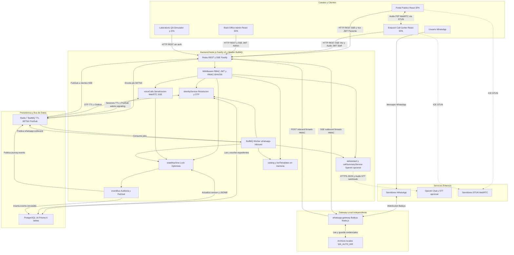

# 01 — Visión General de Arquitectura y Fronteras del Sistema

Esta auditoría documenta la arquitectura real implementada en el repositorio **Salud Digna Omnicanal (Beta v2)**, construida exclusivamente a partir del código fuente, esquemas Prisma y archivos de configuración presentes en el proyecto.

---

## 1. Resumen real del sistema

El repositorio implementa un sistema de orquestación de solicitudes y citas clínicas que mantiene el estado de un trámite (`service_cases`) y su historial de eventos (`journey_events`) a través de tres canales principales:

1. **Portal Público Web (SPA React):** permite explorar el catálogo de estudios/clínicas, crear cuenta de paciente, agendar para el titular o para un familiar/tercero (multibeneficiario), pausar trámites como borrador y rastrear el progreso en tiempo real vía Server-Sent Events (SSE).
2. **Canal WhatsApp (Dual Adapter):** opera mediante un proceso local independiente basado en `@whiskeysockets/baileys` (`whatsapp-gateway/`) que se comunica con el backend usando firma HMAC-SHA256 bidireccional, más un simulador QA HTTP en el frontend (`/lab/whatsapp`) que invoca el mismo motor de reglas.
3. **Estación Call Center y Back-Office Admin (SPA React):** vistas aisladas protegidas por JWT con RBAC (`ASESOR` y `ADMIN`) que reciben eventos en tiempo real vía SSE para Screen-Pop, confirmación de citas, observabilidad de colas y auditoría con PII enmascarada.

---

## 2. Fronteras del sistema (Interno vs. Infraestructura vs. Externo)

### Módulos internos en este repositorio
- **`frontend/`**: SPA construida con React 18, TypeScript, Vite 6, React Router v6 y Tailwind CSS. En contenedor se sirve como estático mediante `nginx:alpine` (`frontend/nginx.conf`) y cuenta con reglas de rewrite SPA para Vercel (`frontend/vercel.json`). Agrupa cuatro entornos de rutas en `frontend/src/App.tsx`: Portal Público (`/`), Back-Office Admin (`/admin`), Call Center (`/call-center`) y Laboratorio QA (`/lab`). Incluye llamadas de voz P2P WebRTC (`frontend/src/lib/webrtcCall.ts`, `PatientVoiceCallBar.tsx` y `AdvisorVoicePanel.tsx`) con grabación dual-track (Web Audio API + `MediaRecorder`).
- **`backend/`**: Servicio Node.js 20 + TypeScript con Fastify v5 (`bodyLimit: 18 MB` para audio Base64), Prisma ORM, Zod, BullMQ e `ioredis`. **En el mismo proceso Node.js** (`backend/src/index.ts`) arranca el servidor HTTP/SSE y el worker BullMQ (`startWhatsAppWorker`, concurrencia `10`). Incorpora señalización WebRTC (`routes/voiceCalls.ts`) y transcripción/resumen de llamadas (`core/callSummaryService.ts` + `routes/callCenter.ts`). Expone documentación OpenAPI/Swagger en `/docs`.
- **`whatsapp-gateway/`**: Proceso Node.js independiente (`whatsapp-gateway/src/index.ts`) que no está declarado en `docker-compose.yml`. Se ejecuta localmente para vincular un número de WhatsApp por código QR con `@whiskeysockets/baileys`, persiste credenciales en el sistema de archivos local (`WA_AUTH_DIR`, por defecto `./auth_info`) y sincroniza mensajes con el backend por HTTPS/HTTP + SSE firmado con HMAC-SHA256.

### Almacenamiento e infraestructura definida en el repositorio (`docker-compose.yml`)
- **PostgreSQL 16 (`postgres:16-alpine`):** almacenamiento transaccional relacional de 6 tablas (`backend/prisma/schema.prisma`).
- **Redis 7 (`redis:7-alpine` con AOF y `maxmemory-policy noeviction`):** cumple cuatro funciones simultáneas en el backend:
  1. Backend de colas BullMQ (`whatsapp-inbound` y `whatsapp-dlq`, prefijo `{bull}`).
  2. Idempotencia atómica `SET NX EX` por `messageId` (`wamid:<id>`).
  3. Estado efímero con TTL (retos OTP, outbox OTP simulado, selección de trámite activo en WhatsApp, historial de chat, buffer de mensajes salientes y sesiones de llamada WebRTC `webrtc:call:<callId>` + set `webrtc:calls:ringing`).
  4. Bus Pub/Sub (`journey:events`, `whatsapp:outbound` y `webrtc:signaling`) para difusión SSE y señalización WebRTC.

### Dependencias externas reales verificadas en código
- **Servidores de WhatsApp (WebSocket):** accedidos únicamente desde `whatsapp-gateway/` vía `@whiskeysockets/baileys`.
- **OpenAI API (`https://api.openai.com/v1/chat/completions` y `https://api.openai.com/v1/audio/transcriptions`):** integración **opcional** en `backend/src/core/aiAssistant.ts` (bot WhatsApp) y `backend/src/core/callSummaryService.ts` (transcripción STT con `OPENAI_STT_MODEL` / fallback `whisper-1` + resumen JSON estructurado de llamadas), activada solo si `OPENAI_API_KEY` está configurada; ante ausencia de clave, error HTTP o timeout, ambos módulos caen automáticamente a su fallback determinístico.
- **Servidores STUN/ICE WebRTC (`stun:stun.l.google.com:19302` y `stun1` por defecto, o `VITE_WEBRTC_ICE_SERVERS`):** utilizados por `RTCPeerConnection` en el navegador (`frontend/src/lib/webrtcCall.ts`) para negociar audio P2P entre Paciente y Asesor de Call Center.

### Integraciones simuladas, ausentes o no verificables en este repositorio
- **Pasarela de pagos:** no existe integración con procesador externo (Stripe, Conekta, OXXO Pay, etc.); `payment_method` (`online`, `oxxo`, `clinic`) se registra como texto y el descuento del 10% se calcula localmente.
- **Proveedor SMS / Correo para 2FA:** no existe envío SMS/SMTP real; los códigos OTP de 6 dígitos se guardan en el hash Redis `demo:otp:outbox` y se consultan vía `GET /api/otp-2fa/inbox` desde la Consola 2FA (`/lab/otp-2fa`).
- **API RENAPO (CURP):** no existe consulta externa; la CURP se calcula con algoritmos locales equivalentes en `frontend/src/lib/curp.ts` y `backend/src/core/aiAssistant.ts`.
- **Catálogo de estudios y clínicas:** no vive en PostgreSQL; está embebido en memoria en `backend/src/data/catalog.ts` (6 estudios y 4 clínicas).
- **Meta Cloud API:** no existe integración ni ruta `/webhooks/whatsapp` (solo persiste una mención en un comentario de `backend/src/index.ts`).
- **Despliegue AWS (ECS Fargate, RDS, ElastiCache Valkey):** `README.md`, `frontend/src/lib/api.ts` (`AWS_API_URL`) y `frontend/src/components/BusArchitectureView.tsx` referencian un entorno en AWS `us-east-2`, pero **no existen archivos Terraform, CloudFormation, CDK ni definiciones de tareas ECS en el repositorio** (`No verificado / Dinámico`).

---

## 3. Diagrama de arquitectura de alto nivel y flujo de datos

---

## 4. Tabla de componentes clave

| Componente / Módulo | Ruta / Archivos | Responsabilidad real | Entradas y salidas de datos |
| --- | --- | --- | --- |
| **SPA Router y 4 Entornos** | `frontend/src/App.tsx`, `frontend/src/components/layouts/*` | Separa visualmente Portal Público, Admin, Call Center y Laboratorio QA; permite cambiar la URL base de API (`Local` vs `AWS Live`) desde `LabLayout`. | Entrada: navegación SPA y eventos `localStorage` (`sd-patient-auth-change`). Salida: renderizado de páginas y peticiones vía `api.ts`. |
| **Cliente HTTP y Estado Local** | `frontend/src/lib/api.ts`, `frontend/src/lib/bookingContext.ts`, `frontend/src/lib/curp.ts` | Centraliza `fetch` con Bearer JWT segregado (`ADMIN`, `ASESOR`, `PATIENT`), persiste borradores `BookingDraft` en `localStorage`, infiere el paso de reanudación y genera CURP determinística. | Entrada: formularios UI y respuestas JSON REST. Salida: requests JSON al backend, lectura/escritura en `localStorage` y `sessionStorage`. |
| **Páginas Portal Público** | `frontend/src/pages/HomePage.tsx`, `LaboratorioPage.tsx`, `PatientRegisterPage.tsx`, `PatientLoginPage.tsx`, `PatientAccountPage.tsx`, `PrivacyPage.tsx` | Wizard de 3 pasos (estudio/clínica, pre-registro titular o familiar, pago/confirmación/pausa), gestión de cuenta, vinculación manual OTP y tracking SSE con `OrderJourneyTracker.tsx`. | Entrada: catálogo, `/api/patients/me`, stream SSE `/api/patients/me/stream`. Salida: `/api/channels/web/*`, `/api/patients/auth/*`, `/api/patients/me/link-channel/*`. |
| **Consolas Operativas y QA** | `frontend/src/pages/CallCenterPage.tsx`, `AdminDashboard.tsx`, `WhatsAppSimPage.tsx`, `Otp2faPage.tsx`, `LabHomePage.tsx`, `frontend/src/components/BusArchitectureView.tsx` | Bandeja de asesores con Screen-Pop SSE; tablero Admin con KPIs, búsqueda con PII enmascarada y vista de bus; simulador WhatsApp y visor polling 2s de OTP. | Entrada: `/api/call-center/queue`, `/api/admin/*`, `/api/stream/events` (SSE), `/api/otp-2fa/inbox`, `/api/channels/whatsapp/history/:phone`. Salida: mutaciones de asignación/confirmación/simulación/reset. |
| **Servidor Estático SPA** | `frontend/Dockerfile`, `frontend/nginx.conf` | Compila la SPA con `VITE_API_URL` en build-time y la sirve en puerto 80 con fallback SPA a `/index.html`. | Entrada: tráfico HTTP del navegador. Salida: assets estáticos cacheados 30 días y SPA HTML. |
| **Gateway WhatsApp Local** | `whatsapp-gateway/src/index.ts`, `whatsapp-gateway/src/crypto.ts` | Conecta una cuenta real de WhatsApp vía Baileys, resuelve identificadores `@lid` en memoria, firma mensajes entrantes con HMAC-SHA256 y consume el stream SSE saliente verificando firma y anti-replay. | Entrada: eventos `messages.upsert` y `contacts.*` de Baileys + stream SSE `/api/gateways/whatsapp/outbound/stream`. Salida: `POST /api/gateways/whatsapp/inbound` y `activeSock.sendMessage`. |
| **Bootstrap Backend Fastify** | `backend/src/index.ts`, `backend/src/config/env.ts` | Valida variables de entorno con Zod, registra CORS, `fastify-raw-body`, Swagger `/docs`, manejador global de errores (`409`, `400`, `500`), las 8 rutas modulares y arranca el worker BullMQ en el mismo proceso. | Entrada: `process.env`, tráfico HTTP/SSE y señales `SIGINT`/`SIGTERM`. Salida: servidor HTTP en `HOST:PORT` y ciclo de vida del worker. |
| **Criptografía y RBAC** | `backend/src/lib/crypto.ts`, `backend/src/middleware/rbac.ts` | Normalización de teléfonos E.164 México, hashes HMAC-SHA256 con `PII_HASH_PEPPER`, enmascaramiento PII, OTP de 6 dígitos, firma/verificación HMAC de gateway con `timingSafeEqual` y JWT segregado (`PATIENT` 7d vs `STAFF` 12h). | Entrada: headers `Authorization`, query `?token=`, `X-Gateway-Signature`/`X-Gateway-Timestamp`, `rawBody`. Salida: `request.patientUser`, `request.staffUser` o HTTP `401`/`403`. |
| **Rutas HTTP y SSE** | `backend/src/routes/health.ts`, `auth.ts`, `patientAuth.ts`, `webChannel.ts`, `whatsappGateway.ts`, `otp2fa.ts`, `callCenter.ts`, `voiceCalls.ts`, `admin.ts` | Exponen 30 endpoints REST/SSE/HTML de salud, catálogo, autenticación, canal web, gateway/simulador WhatsApp, bandeja OTP, Call Center (incluye procesamiento/aplicación de resúmenes IA de llamadas), señalización WebRTC y observabilidad administrativa. | Entrada: requests HTTP (hasta 18 MB para audio Base64) validados con Zod y mensajes Redis Pub/Sub. Salida: respuestas JSON/HTML, frames SSE y encolado en BullMQ. |
| **Voz WebRTC y Grabación Dual-Track (Frontend)** | `frontend/src/lib/webrtcCall.ts`, `frontend/src/components/PatientVoiceCallBar.tsx`, `frontend/src/components/AdvisorVoicePanel.tsx`, `frontend/vercel.json` | Gestionan llamadas de voz P2P WebRTC (`RTCPeerConnection` + STUN), mezcla de audio local y remoto (`DualTrackAudioRecorder` con Web Audio API + `MediaRecorder`), respaldo manual por archivo/texto y rewrites SPA en Vercel. | Entrada: micrófono local, audio remoto WebRTC, streams SSE `/api/voice/stream/*`. Salida: SDP offer/answer, candidatos ICE, audio Base64 o transcripción a `/api/call-center/cases/:id/calls/process`. |
| **Transcripción STT y Resumen IA de Llamadas** | `backend/src/core/callSummaryService.ts` | Transcribe audio con OpenAI (`/v1/audio/transcriptions`, `OPENAI_STT_MODEL` -> fallback `whisper-1`), sanitiza PII (`scrubCallTranscriptPii`: CURP, tarjetas y OTP), genera resumen JSON estructurado + entidades validadas contra catálogo con fallback determinístico. | Entrada: `audioBase64` o `transcriptText`, `currentCtx`. Salida: `CallSummaryRecord` almacenado en `service_cases.context_json.call_summaries` y difundido en `journey_events` (`patientSafeSummary`). |
| **Motor de Identidad y OTP** | `backend/src/core/identityService.ts` | Resuelve o crea pacientes y beneficiarios (`PatientRelationship`), ejecuta fusión transaccional (`mergePatientProfiles`) protegiendo CURPs distintas, y gestiona retos Step-Up OTP y vinculación manual en Redis. | Entrada: identificadores (`PHONE`, `CURP`, `EMAIL`, `WEB_SESSION`, `APP/LID`), códigos OTP. Salida: mutaciones en `patients`, `identity_links`, `patient_relationships`, `service_cases`, llaves OTP en Redis y eventos en `eventBus`. |
| **Máquina de Estados** | `backend/src/core/stateMachine.ts` | Valida transiciones sobre los 8 estados canónicos, fusiona `context_json`, regenera `beneficiary_summary` y `handoff_summary`, y aplica bloqueo optimista sobre `service_cases.version` (`HTTP 409` en conflicto). | Entrada: `TransitionCaseInput` (`caseId`, `expectedVersion`, `nextState`, `contextPatch`). Salida: `ServiceCase` actualizado en PostgreSQL y evento delegado a `recordAndPublishEvent`. |
| **Bus de Eventos** | `backend/src/core/eventBus.ts`, `backend/src/lib/redis.ts`, `backend/src/lib/prisma.ts` | Persiste auditoría inmutable en `journey_events` con `correlation_id` y publica payload con nombre enmascarado en Redis Pub/Sub `journey:events`. | Entrada: `EmitEventInput`. Salida: registro en `journey_events` y publicación Redis Pub/Sub. |
| **Cola y Motor WhatsApp** | `backend/src/queues/whatsappQueue.ts`, `backend/src/data/catalog.ts`, `backend/src/data/botTemplates.ts` | Define colas BullMQ (`whatsapp-inbound`, `whatsapp-dlq`), worker (`concurrency: 10`), selección multibeneficiario, compuerta Step-Up OTP, fallback determinístico por regex/plantillas y publicación firmada a `whatsapp:outbound`. | Entrada: jobs `WhatsAppInboundJob` (Baileys o simulador). Salida: transiciones de `ServiceCase`, historial en Redis `sim:wa:chat:<phone>` y sobres `SignedOutboundEnvelope` en Pub/Sub o `gw:wa:outbound:pending`. |
| **Plugin NLU OpenAI** | `backend/src/core/aiAssistant.ts` | Envoltorio opcional de OpenAI Chat Completions con 12 tools (Function Calling, hasta 2 rondas), sanitización PII previa (`scrubPotentialPii`), extracción/generación de CURP en servidor y validación estricta antes de confirmar citas. | Entrada: `ServiceCase`, historial chat, `userText`, catálogos en memoria y datos Prisma. Salida: llamadas a `transitionServiceCase`/`identityService` y texto de respuesta (o `null` para fallback). |
| **Esquema, Seed y Pruebas QA** | `backend/prisma/schema.prisma`, `backend/prisma/migrations/*`, `backend/prisma/seed.ts`, `backend/src/scripts/testReliability.ts` | Define 6 tablas y 8 enums PostgreSQL, siembra usuarios demo (`admin`, `asesor`, paciente `Ana`) en cada arranque de contenedor (`backend/Dockerfile`), y ejecuta 5 pruebas automatizadas de confiabilidad contra HTTP. | Entrada: `DATABASE_URL` y `TEST_BASE_URL`. Salida: esquema migrado, datos semilla y reporte de pruebas (HMAC, SETNX, 409, OTP, ráfaga de 60 requests). |

---

## 5. Incertidumbres / Por verificar

- **Topología productiva en AWS (`No verificado / Dinámico`):** El código cliente (`frontend/src/lib/api.ts`) y la documentación interna (`README.md`, `BusArchitectureView.tsx`) mencionan AWS ECS Fargate, AWS RDS PostgreSQL y AWS ElastiCache Valkey en `us-east-2`, pero la configuración real de red, balanceador, TLS, secretos administrados y número de réplicas no está versionada en este repositorio.
- **Ejecución simultánea de múltiples réplicas del backend (`No verificado / Dinámico`):** Aunque Redis Pub/Sub y BullMQ permiten múltiples instancias, el arranque de `backend/Dockerfile` ejecuta `prisma migrate deploy && tsx prisma/seed.ts && node dist/index.js` en cada contenedor, y el worker BullMQ corre embebido en el mismo proceso que Fastify; no hay configuración de despliegue en el repo que verifique si en producción corren 1 o N réplicas.
