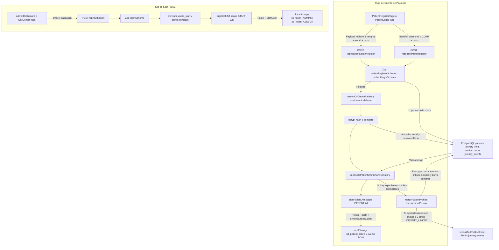
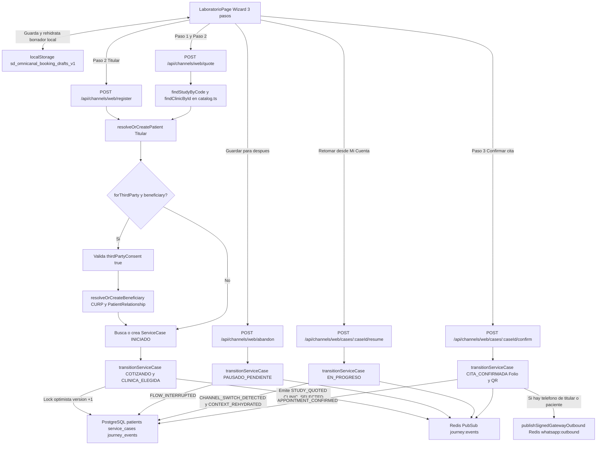
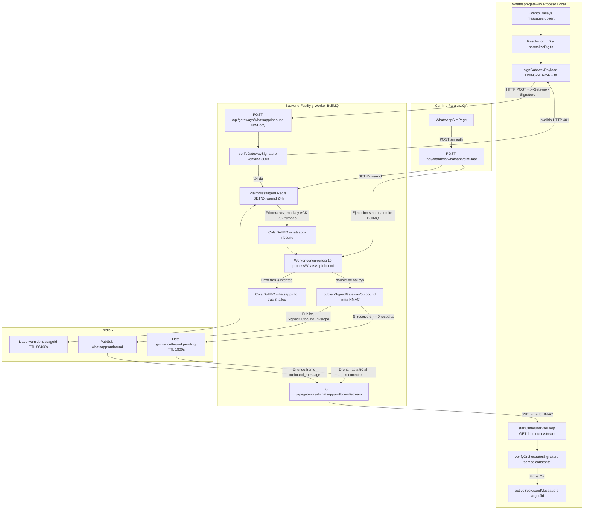
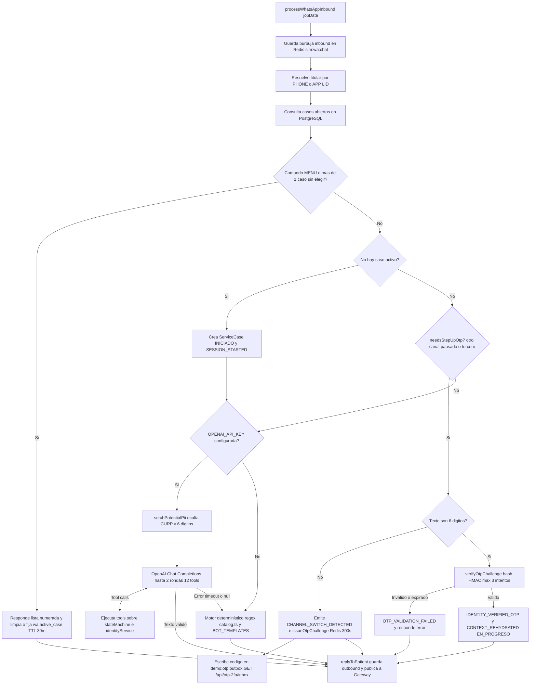
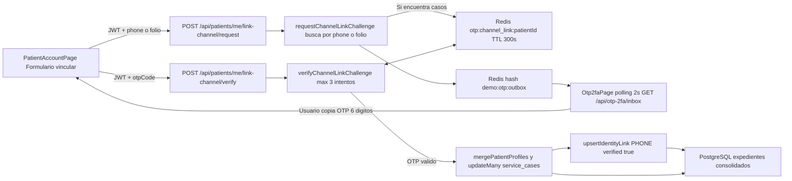
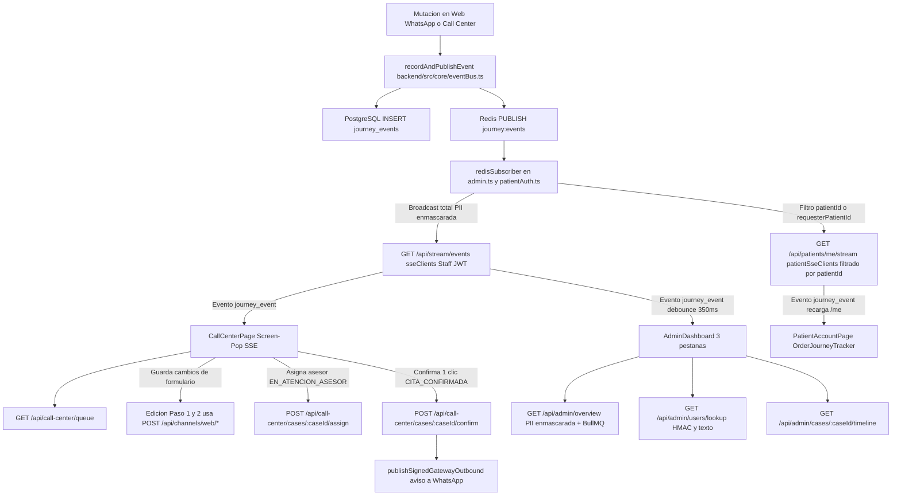
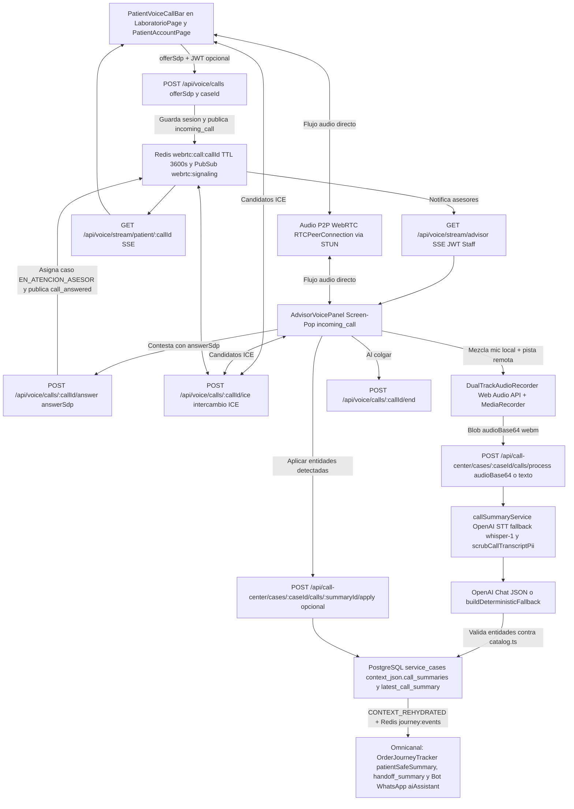

# 02 — Flujos de Datos Críticos (Extremo a Extremo)

Este documento reconstruye los seis flujos de datos críticos del sistema a partir de la ejecución real observada en `frontend/`, `backend/` y `whatsapp-gateway/`. Cada diagrama muestra cómo se valida, transforma, persiste y difunde la información desde su origen hasta su destino final.

---

## Flujo 1 — Registro, Autenticación y Reconciliación Omnicanal (Pacientes y Staff)

Cubre los dos esquemas de autenticación segregados por `scope` de JWT (`PATIENT` vs `STAFF`) y la fusión automática de expedientes sombra (creados previamente en WhatsApp, Call Center o sesión web invitada) al registrarse, iniciar sesión o consultar `/api/patients/me`.

### Traza paso a paso (evidencia real)
1. **Registro de paciente:** `PatientRegisterPage.tsx` genera la CURP determinísticamente con `generateDeterministicCurp` (`frontend/src/lib/curp.ts`) y envía los 9 campos más correo, contraseña y `webSessionId` a `POST /api/patients/auth/register` (`backend/src/routes/patientAuth.ts`).
2. **Validación y resolución:** `patientRegisterSchema.parse` valida el payload. Si el correo no tiene `passwordHash`, `resolveOrCreatePatient` (`backend/src/core/identityService.ts`) busca candidatos por `CURP`, `PHONE`, `EMAIL` y `WEB_SESSION`, selecciona el expediente maestro (`pickCanonicalMaster`) y fusiona registros compatibles (`canSafelyMergePatients` impide fusionar dos CURPs diferentes o dos cuentas con `passwordHash`).
3. **Persistencia de credenciales y reconciliación:** Se calcula `bcrypt.hash(password, 10)`, se actualiza `patients`, se crea `identity_links` (`EMAIL`, `verified: true`) y se ejecuta `reconcilePatientOmnichannelHistory` -> `mergePatientProfiles` dentro de `prisma.$transaction`, reasignando `service_cases`, `journey_events`, `identity_links` y `patient_relationships` y borrando los registros sombra. Si hubo casos sincronizados, publica `IDENTITY_LINKED` vía `recordAndPublishEvent`.
4. **Login de paciente:** `POST /api/patients/auth/login` resuelve al paciente por correo, CURP (18 chars) o teléfono normalizado con `passwordHash != null`, valida `bcrypt.compare`, ejecuta `reconcilePatientOmnichannelHistory` y devuelve `signPatientJwt` (`expiresIn: "7d"`, `scope: "PATIENT"`). En el navegador, `savePatientSession` (`frontend/src/lib/api.ts`) guarda en `localStorage` y dispara `window.dispatchEvent(new Event("sd-patient-auth-change"))`.
5. **Login de Staff (RBAC):** `POST /api/auth/login` (`backend/src/routes/auth.ts`) autentica contra `users_staff` (`active: true`), verifica `bcrypt.compare` y emite `signStaffJwt` (`expiresIn: "12h"`, `scope: "STAFF"`). El middleware `requireStaffRole` (`backend/src/middleware/rbac.ts`) valida rol (`ADMIN` o `ASESOR`) desde header `Authorization: Bearer` o query `?token=`.

---

## Flujo 2 — Cotización Web, Soporte Multibeneficiario, Pausa y Confirmación

Cubre el wizard de 3 pasos en `LaboratorioPage.tsx` (incluyendo agendamiento para un tercero con expediente separado) y la reanudación bidireccional de trámites en Web.

### Traza paso a paso (evidencia real)
1. **Carga inicial y rehidratación:** Al montar `LaboratorioPage.tsx`, consulta `GET /api/catalog` y, si hay JWT de paciente, `GET /api/patients/me` (o `GET /api/channels/web/case?webSessionId=...` si es invitado). Si recibe `?resumeCaseId=`, `hydrateFromCase` combina `serviceCase.contextJson` con `getBookingDraft(caseId)` de `localStorage` e invoca `inferResumeStep` (`frontend/src/lib/bookingContext.ts`).
2. **Paso 1 y 2 (`POST /api/channels/web/quote`):** `backend/src/routes/webChannel.ts` valida el payload con `quoteSchema`, busca estudio y clínica en `backend/src/data/catalog.ts` y resuelve al titular con `resolveOrCreatePatient`.
3. **Bifurcación Multibeneficiario:** Si `forThirdParty && beneficiary`, exige `thirdPartyConsent === true` (si no, responde `400 CONSENT_REQUIRED`) y ejecuta `resolveOrCreateBeneficiary` (`backend/src/core/identityService.ts`), que crea/actualiza un registro independiente en `patients` indexado solo por su propia `CURP` en `identity_links` (sin apropiarse del `PHONE` del titular) y hace upsert en `patient_relationships`.
4. **Transición con bloqueo optimista:** Se crea el `ServiceCase` (`patientId = beneficiario`, `requesterPatientId = titular`) o se detecta salto de canal (`CHANNEL_SWITCH_DETECTED`). Luego `transitionServiceCase` (`backend/src/core/stateMachine.ts`) actualiza `service_cases` con `WHERE id = ? AND version = expectedVersion` (`version: { increment: 1 }`). Si otro canal modificó la fila antes, `updateResult.count === 0` lanza `OptimisticLockError` -> HTTP `409 OPTIMISTIC_LOCK_CONFLICT`.
5. **Pausa, reanudación y confirmación:**
   - `POST /api/channels/web/abandon` transiciona a `PAUSADO_PENDIENTE` (`FLOW_INTERRUPTED`).
   - `POST /api/channels/web/cases/:caseId/resume` emite `CHANNEL_SWITCH_DETECTED` (si venía de otro canal) y transiciona a `EN_PROGRESO` (`CONTEXT_REHYDRATED`).
   - `POST /api/channels/web/cases/:caseId/confirm` genera `folio = SD-2026-XXXX` y `qr_payload`, transiciona a `CITA_CONFIRMADA`, limpia el borrador local (`clearBookingDraft`) y llama a `publishSignedGatewayOutbound` para enviar confirmación firmada al teléfono del titular/paciente vía WhatsApp.

---

## Flujo 3 — Ingesta Asíncrona WhatsApp (Gateway Baileys HMAC-SHA256, BullMQ y Salida SSE)

Muestra el transporte bidireccional cifrado/firmado entre `whatsapp-gateway/` y `backend/`, incluyendo idempotencia atómica, reintentos, Dead Letter Queue (DLQ) y el camino paralelo síncrono del Simulador QA.

### Traza paso a paso (evidencia real)
1. **Recepción y mapeo LID en el Gateway (`whatsapp-gateway/src/index.ts`):** El listener `messages.upsert` descarta mensajes propios (`fromMe`), grupos (`@g.us`) y estados (`status@broadcast`), extrae texto con `extractTextMessage`, intenta mapear JIDs `@lid` usando `remoteJidAlt`/`participantAlt` o `lidToPhoneMap` (alimentado por `contacts.upsert`/`contacts.update`) y marca `isUnresolvedLid` si no hay teléfono visible.
2. **Firma E2E entrante:** `forwardInboundToOrchestrator` firma `${timestamp}.${rawBody}` con `signGatewayPayload` (`v1=<hmac_sha256_hex>`) y envía `POST /api/gateways/whatsapp/inbound` con headers `X-Gateway-Timestamp` y `X-Gateway-Signature`.
3. **Verificación, idempotencia y encolado (`backend/src/routes/whatsappGateway.ts`):** La ruta activa `config: { rawBody: true }`, valida firma y ventana anti-replay (`GATEWAY_SIGNATURE_TTL_SECONDS`, default `300s`) con `crypto.timingSafeEqual`, reclama el mensaje con `redis.set("wamid:" + id, "1", "EX", WAMID_TTL_SECONDS, "NX")` (si ya existe responde `200 duplicate_ignored`), agrega el job a `whatsappInboundQueue` y responde `202 Accepted` con ACK firmado (`X-Orchestrator-Signature` y `X-Orchestrator-Timestamp`).
4. **Procesamiento asíncrono y DLQ (`backend/src/queues/whatsappQueue.ts`):** `startWhatsAppWorker` consume `whatsapp-inbound` con `concurrency: 10`, hasta `3` intentos con backoff exponencial (`1000ms`). Al agotarse los reintentos, el listener `failed` mueve el payload a `whatsappDlqQueue` (`whatsapp-dlq`).
5. **Entrega saliente firmada y buffer de reconexión:** `replyToPatient` guarda siempre la burbuja en Redis (`sim:wa:chat:<phone>`, máx. 50 mensajes, TTL 24h) y, cuando `source === "baileys"`, llama a `publishSignedGatewayOutbound`, que firma el sobre y publica en Redis Pub/Sub `whatsapp:outbound`. Si `receivers === 0`, lo resguarda en `gw:wa:outbound:pending` (hasta 100 elementos, TTL 1800s), drenado por `drainPendingGatewayOutbound` (hasta 50 mensajes por reconexión) cuando el gateway abre `GET /api/gateways/whatsapp/outbound/stream` firmando `GET:/api/gateways/whatsapp/outbound/stream`.
6. **Diferencia del Simulador QA:** `POST /api/channels/whatsapp/simulate` comparte `claimMessageId` (`SETNX`), pero invoca `processWhatsAppInbound` de forma síncrona (sin pasar por BullMQ) y devuelve `{ reply, history }` en la misma respuesta HTTP.

---

## Flujo 4 — Orquestación Interna de WhatsApp: Multibeneficiario, Step-Up OTP e IA / Fallback

Detalla la lógica interna de `processWhatsAppInbound` (`backend/src/queues/whatsappQueue.ts`) y `runSmartWhatsAppAssistant` (`backend/src/core/aiAssistant.ts`).

### Traza paso a paso (evidencia real)
1. **Resolución de titular y selección de caso:** Si `isUnresolvedLid` es verdadero, busca por `IdentifierType.APP` (`LID:<digits>`); de lo contrario usa `resolveOrCreatePatient({ phone, whatsappLid })`. Consulta hasta 10 casos no confirmados donde el titular sea `requesterPatientId` o `patientId`.
2. **Menú multibeneficiario:** Si el usuario escribe `MENU`/`CAMBIAR`/`MIS CITAS` o existen `> 1` casos abiertos sin clave activa en Redis `wa:active_case:<phone>`, envía un menú numerado con nombres enmascarados (`maskPatientName`) y guarda la selección con TTL de `1800s`.
3. **Compuerta Step-Up OTP (`needsStepUpOtp`):** Se activa si `"WHATSAPP"` no está en `contextJson.otp_verified_channels` y además el caso proviene de otro canal (`currentChannel !== WHATSAPP`), está en `PAUSADO_PENDIENTE`, o es de un tercero (`patientId !== holder.id`).
   - Sin código de 6 dígitos: emite `CHANNEL_SWITCH_DETECTED`, ejecuta `issueOtpChallenge` (guarda `hashOtp` en `otp:challenge:<patientId>` con TTL `OTP_TTL_SECONDS`, escribe el código en `demo:otp:outbox` y audita `OTP_CHALLENGE_SENT`).
   - Con código de 6 dígitos: `verifyOtpChallenge` compara hashes; si falla incrementa `attempts` (al llegar a `OTP_MAX_ATTEMPTS = 3` revoca la llave) y audita `OTP_VALIDATION_FAILED`; si acierta borra el reto, marca `identity_links.PHONE.verified = true`, audita `IDENTITY_VERIFIED_OTP` y transiciona el caso a `EN_PROGRESO` (`CONTEXT_REHYDRATED`) agregando `"WHATSAPP"` a `otp_verified_channels`.
4. **Plugin OpenAI Function Calling (`backend/src/core/aiAssistant.ts`):** Cuando `env.OPENAI_API_KEY` está presente:
   - Extrae cualquier CURP del texto crudo en servidor (`extractCurpFromRawText`) y limpia CURPs y códigos de 6 dígitos con `scrubPotentialPii` antes de enviar los mensajes a `https://api.openai.com/v1/chat/completions` (con `AbortSignal.timeout(env.OPENAI_TIMEOUT_MS)`).
   - Expone 12 herramientas (`get_patient_context`, `search_catalog`, `quote_study`, `select_clinic_and_slot`, `update_preferred_slot`, `update_patient_profile`, `link_existing_account`, `set_payment_method`, `pause_case_for_later`, `switch_or_create_case`, `log_question_or_escalate`, `confirm_appointment`) ejecutadas hasta en 2 rondas. Todas las mutaciones pasan por `transitionServiceCase`, `resolveOrCreateBeneficiary` o `mergePatientProfiles`.
   - `confirm_appointment` valida estrictamente que existan estudio, clínica, fecha/hora, forma de pago y nombre + apellido paterno antes de generar Folio y QR.
5. **Fallback determinístico (`whatsappQueue.ts`):** Si no hay `OPENAI_API_KEY` o `runSmartWhatsAppAssistant` retorna `null`, se aplican expresiones regulares sobre `STUDIES_CATALOG`, `CLINICS_CATALOG` y `BOT_TEMPLATES` (`backend/src/data/botTemplates.ts`), permitiendo cotizar, elegir clínica, escalar a asesor (`DUDAS_ABIERTAS`), confirmar (`CONFIRMAR`/`AGENDAR`) o registrar dudas abiertas (`PATIENT_QUESTION_LOGGED`).

---

## Flujo 5 — Vinculación Manual de Teléfono o Folio Secundario con OTP (`Mi Cuenta`)

Permite a un paciente autenticado en el portal web vincular trámites históricos creados desde otro número telefónico o folio de WhatsApp/Call Center tras superar un reto OTP.

### Traza paso a paso (evidencia real)
1. **Solicitud (`POST /api/patients/me/link-channel/request`):** Protegida por `requirePatientAuth` (`backend/src/routes/patientAuth.ts`). `requestChannelLinkChallenge` (`backend/src/core/identityService.ts`) busca pacientes compatibles por teléfono normalizado o inspecciona hasta los últimos 100 `service_cases` comparando `contextJson.appointment_folio`.
2. **Emisión OTP en Redis:** Guarda `ChannelLinkOtpRecord` (`otpHash`, `targetPatientIds`, `targetCaseIds`, `attempts: 0`) en `otp:channel_link:<patientId>` con TTL `OTP_TTL_SECONDS` y publica el código en `demo:otp:outbox` (visible en `Otp2faPage.tsx` mediante polling cada 2 segundos a `GET /api/otp-2fa/inbox`).
3. **Verificación y consolidación (`POST /api/patients/me/link-channel/verify`):** `verifyChannelLinkChallenge` valida el hash HMAC del OTP (máximo 3 intentos). Si es válido, elimina el reto, ejecuta `mergePatientProfiles` para los `targetPatientIds`, actualiza `requesterPatientId` en los `targetCaseIds` que pertenezcan a otro paciente y registra el `IdentityLink` de tipo `PHONE` con `verified: true`.

---

## Flujo 6 — Atención en Call Center (Screen-Pop SSE), Confirmación y Observabilidad Admin

Muestra cómo los eventos generados en cualquier canal se difunden en tiempo real vía Redis Pub/Sub hacia las sesiones SSE de Call Center, Admin y Portal de Pacientes, y cómo opera la estación del asesor.

### Traza paso a paso (evidencia real)
1. **Publicación centralizada (`backend/src/core/eventBus.ts`):** Cada evento de negocio llama a `recordAndPublishEvent`, que inserta un registro inmutable en `journey_events` (con `correlationId` UUID) y publica en Redis `journey:events` un JSON con `patientMasked` (nunca el nombre completo), `patientId`, `requesterPatientId`, `channel`, `eventType`, `prevState` y `nextState`.
2. **Puente Redis Pub/Sub -> SSE:**
   - `adminRoutes` (`backend/src/routes/admin.ts`) suscribe `redisSubscriber` a `journey:events` y envía `event: journey_event` a todos los sockets en `sseClients` conectados a `GET /api/stream/events` (accesible a `ASESOR` y `ADMIN`).
   - `patientAuthRoutes` (`backend/src/routes/patientAuth.ts`) escucha el mismo canal y filtra estrictamente los envíos a `patientSseClients` (`GET /api/patients/me/stream`) comparando `parsed.patientId === subscribedPatientId || parsed.requesterPatientId === subscribedPatientId`.
   - Todos los streams SSE escriben un comentario `: heartbeat <timestamp>` cada `15000ms` para mantener viva la conexión.
3. **Flujo operativo en Call Center (`frontend/src/pages/CallCenterPage.tsx` y `backend/src/routes/callCenter.ts`):**
   - Al llegar un evento SSE, muestra un banner `Screen-Pop en vivo`, selecciona automáticamente el `caseId` del evento y recarga `GET /api/call-center/queue` (últimos 30 casos con datos completos del paciente y hasta 25 eventos).
   - **Nota real del código:** Cuando el asesor edita el Paso 1, Paso 2 o pausa un borrador en `CallCenterPage.tsx`, invoca los endpoints del canal Web (`registerWebPatient`, `quoteWebStudy`, `abandonWebCase`) antes de llamar a `POST /api/call-center/cases/:caseId/assign` (`EN_ATENCION_ASESOR`, `ADVISOR_ASSIGNED`).
   - Al confirmar en `POST /api/call-center/cases/:caseId/confirm`, transiciona a `CITA_CONFIRMADA` (generando Folio y QR), registra `advisorNotes` en el evento y dispara `publishSignedGatewayOutbound` hacia el Gateway Baileys.
4. **Flujo de observabilidad en Admin (`frontend/src/pages/AdminDashboard.tsx` y `backend/src/routes/admin.ts`):**
   - Al recibir eventos por SSE, aplica un debounce de `350ms` y consulta `GET /api/admin/overview` (KPIs globales, conteos reales de `whatsappInboundQueue` y `whatsappDlqQueue`, y hasta 50 casos con `patientMasked` y `identities` enmascaradas) y `GET /api/health`.
   - En la pestaña de consulta de usuario, `GET /api/admin/users/lookup?q=` busca por UUID (`journeyId`/`caseId`/`patientId`), por hash HMAC en `identity_links` (`EMAIL`/`CURP`/`PHONE`) y por coincidencia parcial `contains` en `patients`, devolviendo expedientes con PII enmascarada.
   - Adicionalmente existe `POST /api/admin/reset-demo` (solo `ADMIN`) para vaciar `journey_events`, `service_cases` y llaves temporales seleccionadas en Redis preservando `users_staff` y el paciente semilla `Ana`.

---

## Flujo 7 — Llamada de Voz WebRTC en Tiempo Real (Portal <-> Call Center), Grabación Dual-Track y Resumen IA (STT)

Documenta la nueva integración de voz en tiempo real entre el paciente (`PatientVoiceCallBar.tsx` en `/laboratorio` y `/mi-cuenta`) y el asesor (`AdvisorVoicePanel.tsx` en `/call-center`), su señalización sobre Redis Pub/Sub + SSE (`voiceCalls.ts`), la grabación dual-track y el pipeline de transcripción + resumen estructurado (`callSummaryService.ts` + `callCenter.ts`).

### Traza paso a paso (evidencia real)
1. **Inicio de llamada (`PatientVoiceCallBar.tsx` -> `POST /api/voice/calls`):** El navegador captura micrófono, crea `RTCPeerConnection` con `getIceServers()` (`VITE_WEBRTC_ICE_SERVERS` o STUN público de Google) y envía `offerSdp` junto con `caseId`/`webSessionId`/`phone` (y JWT paciente opcional). `backend/src/routes/voiceCalls.ts` resuelve o crea el `ServiceCase` (en `DUDAS_ABIERTAS` si no existía), guarda `VoiceCallSession` en Redis `webrtc:call:<callId>` (TTL `3600s`) y en el set `webrtc:calls:ringing`, y publica `incoming_call` en Redis Pub/Sub `webrtc:signaling`.
2. **Señalización y respuesta (`AdvisorVoicePanel.tsx` -> `POST /api/voice/calls/:callId/answer`):** El asesor conectado a `GET /api/voice/stream/advisor` (protegido con `requireStaffRole([ASESOR, ADMIN])`) recibe `incoming_call` (o llamadas en espera al reconectar). Al contestar, inicia `DualTrackAudioRecorder` (`frontend/src/lib/webrtcCall.ts`), genera `answerSdp` y lo envía a `/answer`, el cual actualiza el estado a `active`, asigna automáticamente el expediente (`EN_ATENCION_ASESOR` / `ADVISOR_ASSIGNED` con `via: "webrtc_voice_call"`) y publica `call_answered` hacia `GET /api/voice/stream/patient/:callId`.
3. **Intercambio ICE y audio P2P:** Ambos extremos intercambian candidatos ICE vía `POST /api/voice/calls/:callId/ice` -> Redis `webrtc:signaling` y establecen el canal de audio P2P directo. `DualTrackAudioRecorder` mezcla la pista local del asesor y la pista remota del paciente mediante `AudioContext` + `MediaStreamAudioDestinationNode` + `MediaRecorder`.
4. **Cierre, transcripción STT y resumen estructurado (`POST /api/call-center/cases/:caseId/calls/process`):** Al finalizar (`POST /api/voice/calls/:callId/end` o al usar el respaldo manual `audio_upload` / `transcript_text` en `AdvisorVoicePanel.tsx`), el audio en Base64 (hasta `bodyLimit: 18 MB` en `backend/src/index.ts`) se procesa en `processCallAudioAndSummarize` (`backend/src/core/callSummaryService.ts`):
   - Transcribe con `POST https://api.openai.com/v1/audio/transcriptions` (`OPENAI_STT_MODEL`, default `gpt-4o-mini-transcribe`, con reintento automático en `whisper-1`).
   - Sanitiza PII con `scrubCallTranscriptPii` (enmascara CURP, tarjetas de 13–16 dígitos y códigos OTP de 6 dígitos).
   - Genera JSON estructurado vía OpenAI Chat Completions (o `buildDeterministicFallback` si falta `OPENAI_API_KEY` o ocurre error/timeout `OPENAI_CALL_TIMEOUT_MS`) con `summary`, `patientSafeSummary`, `agreements`, `pendingActions`, `openQuestions`, `sentiment` y `extractedEntities` validadas contra `STUDIES_CATALOG` y `CLINICS_CATALOG`.
5. **Integración omnicanal y aplicación de entidades:** `callCenter.ts` guarda hasta 15 `call_summaries` y `latest_call_summary` en `service_cases.context_json`, re-lee la versión más reciente tras la llamada a OpenAI y ejecuta `transitionServiceCase` (`CONTEXT_REHYDRATED`, `via: "call_ai_summary"`). Si el asesor pulsa **"Aplicar datos al trámite"**, `POST /api/call-center/cases/:caseId/calls/:summaryId/apply` aplica estudio/clínica/horario/pago al caso. El resumen se propaga automáticamente a:
   - `OrderJourneyTracker.tsx` en `/mi-cuenta` (muestra `patientSafeSummary`).
   - `buildDeterministicHandoffSummary` en `stateMachine.ts`.
   - El prompt del bot WhatsApp y el tool `get_patient_context` en `backend/src/core/aiAssistant.ts`.
