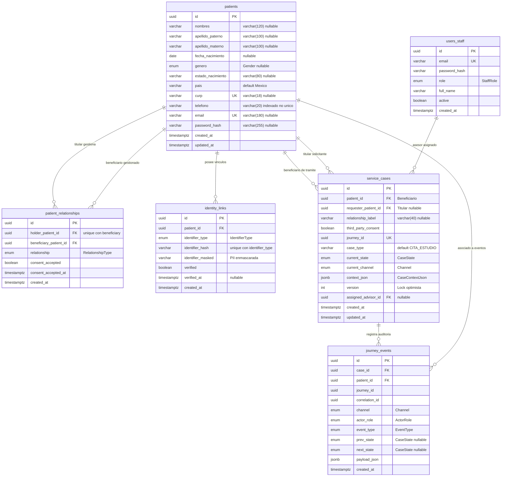
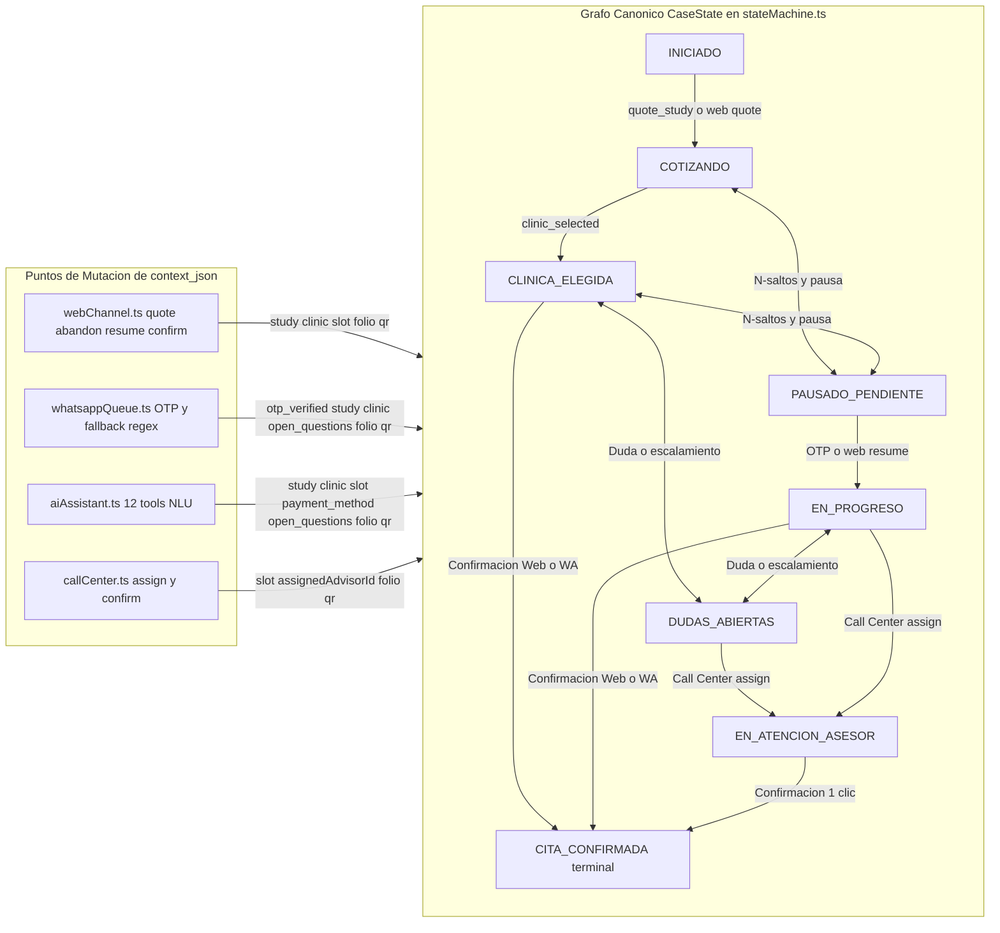

# 03 — Modelos de Datos, Estado y Configuración

Este documento detalla cómo se estructura, muta y persiste la información en PostgreSQL 16, Redis 7, el navegador (SPA React) y la memoria de procesos, así como las variables de entorno y los puntos ciegos detectados durante la auditoría.

---

## 1. Modelo de Datos Relacional (PostgreSQL 16 / Prisma)

El esquema definido en `backend/prisma/schema.prisma` (y sus 3 migraciones SQL en `backend/prisma/migrations/`) consta de **6 tablas** y **8 enums canónicos**.

### Enums canónicos verificados (`backend/prisma/schema.prisma`)
- **`IdentifierType`**: `WEB_SESSION`, `PHONE`, `EMAIL`, `CURP`, `APP` (usado también para guardar identificadores WhatsApp `@lid` con formato `LID:<digitos>`).
- **`Gender`**: `MASCULINO`, `FEMENINO`, `OTRO`, `NO_ESPECIFICADO`.
- **`RelationshipType`**: `SELF`, `HIJO_A`, `PADRE_MADRE`, `CONYUGE`, `ABUELO_A`, `FAMILIAR`, `CONOCIDO`.
- **`Channel`**: `WEB`, `WHATSAPP`, `CALL_CENTER`, `APP`, `SYSTEM`.
- **`CaseState`** (8 estados): `INICIADO`, `COTIZANDO`, `CLINICA_ELEGIDA`, `PAUSADO_PENDIENTE`, `EN_PROGRESO`, `DUDAS_ABIERTAS`, `EN_ATENCION_ASESOR`, `CITA_CONFIRMADA`.
- **`ActorRole`**: `PATIENT`, `BOT`, `ADVISOR`, `ADMIN`, `SYSTEM`.
- **`EventType`** (13 eventos): `SESSION_STARTED`, `STUDY_QUOTED`, `CLINIC_SELECTED`, `IDENTITY_LINKED`, `FLOW_INTERRUPTED`, `CHANNEL_SWITCH_DETECTED`, `OTP_CHALLENGE_SENT`, `OTP_VALIDATION_FAILED`, `IDENTITY_VERIFIED_OTP`, `CONTEXT_REHYDRATED`, `PATIENT_QUESTION_LOGGED`, `ADVISOR_ASSIGNED`, `APPOINTMENT_CONFIRMED`.
- **`StaffRole`**: `ASESOR`, `ADMIN`.

### Restricciones e invariantes clave de datos
- `patients.telefono` **no es único** (la restricción única se eliminó en la migración `20261124190000_beta2_multibeneficiary`) para permitir que un mismo titular comparta número con sus beneficiarios mientras `patients.curp` y `patients.email` siguen siendo únicos.
- `identity_links` mantiene unicidad compuesta `uq_identity_type_hash(identifier_type, identifier_hash)`, donde `identifier_hash = HMAC-SHA256(PII_HASH_PEPPER, valor_normalizado_en_minusculas)`.
- `service_cases` separa explícitamente `patient_id` (beneficiario del estudio) de `requester_patient_id` (titular que gestiona la cita).

---

## 2. Máquina de Estados y Mutación de `service_cases.context_json`

Toda mutación de estado pasa por `transitionServiceCase` (`backend/src/core/stateMachine.ts`), que valida la transición contra `ALLOWED_TRANSITIONS`, fusiona `contextPatch` en `context_json`, recalcula `beneficiary_summary` y `handoff_summary`, incrementa `version` con bloqueo optimista (`WHERE id = ? AND version = expectedVersion`) y delega el evento a `recordAndPublishEvent`.

> **Nota sobre transiciones permitidas:** En `ALLOWED_TRANSITIONS` (`backend/src/core/stateMachine.ts:58-120`), casi todos los estados intermedios (`COTIZANDO`, `CLINICA_ELEGIDA`, `PAUSADO_PENDIENTE`, `EN_PROGRESO`, `DUDAS_ABIERTAS`, `EN_ATENCION_ASESOR`) permiten transiciones bidireccionales entre sí y hacia `CITA_CONFIRMADA` para habilitar N-saltos. Únicamente `INICIADO` no puede saltar directamente a `CITA_CONFIRMADA`, y `CITA_CONFIRMADA` solo admite auto-transición (`CITA_CONFIRMADA -> CITA_CONFIRMADA`).

### Estructura real de `CaseContextJson` (`backend/src/core/stateMachine.ts`)

| Campo JSONB | Tipo | Quién lo escribe | Observación real |
| --- | --- | --- | --- |
| `study` | `{ code, name, price, prep }` | `webChannel.ts`, `whatsappQueue.ts`, `aiAssistant.ts` | Tomado de `STUDIES_CATALOG` en memoria. |
| `clinic` | `{ id, name, city?, address? }` | `webChannel.ts`, `whatsappQueue.ts`, `aiAssistant.ts` | Tomado de `CLINICS_CATALOG` en memoria. |
| `preferred_slot` | `{ date, time }` | `webChannel.ts`, `aiAssistant.ts`, `callCenter.ts` | Fecha `YYYY-MM-DD` y hora `HH:MM`. |
| `payment_method` | `"online" \| "oxxo" \| "clinic"` | `aiAssistant.ts`, `callCenter.ts` (`/calls/process` y `/apply`) | En Web (`webChannel.ts`) solo se envía en `eventPayload` al confirmar y vive en `localStorage` antes; ya está tipado en `frontend/src/types/api.ts`. |
| `open_questions` | `string[]` | `whatsappQueue.ts`, `aiAssistant.ts`, `voiceCalls.ts`, `callCenter.ts` | Arreglo acumulativo de dudas, solicitudes de asesor o preguntas detectadas en llamadas. |
| `call_summaries` | `CallSummaryRecord[]` (máx. 15) | `callCenter.ts` (`/calls/process` vía `callSummaryService.ts`) | Historial de resúmenes IA de llamadas WebRTC/audio/texto (`summary`, `patientSafeSummary`, `agreements`, `pendingActions`, `sentiment`, `extractedEntities`, `transcriptPreview` sanitizado). |
| `latest_call_summary` | `string` | `callCenter.ts` (`/calls/process`) | Resumen ejecutivo de la última llamada; inyectado en `handoff_summary` (`stateMachine.ts`) y en el prompt/contexto del bot WhatsApp (`aiAssistant.ts`). |
| `appointment_folio` | `string \| null` | `webChannel.ts`, `whatsappQueue.ts`, `aiAssistant.ts`, `callCenter.ts` | Formato `SD-2026-<4 digitos aleatorios>`. |
| `qr_payload` | `string \| null` | Mismos 4 módulos al confirmar | Formato `SALUDDIGNA|<folio>|<studyCode>|<clinicId>`. |
| `otp_verified_channels` | `string[]` | Creación de caso y `whatsappQueue.ts` tras OTP | Contiene canales verificados (`"WEB"`, `"WHATSAPP"`). |
| `beneficiary_summary` | `{ is_third_party, relationship, beneficiary_name, requester_name? }` | Recalculado en cada `transitionServiceCase` | No está declarado en el tipo `CaseContextJson` de `frontend/src/types/api.ts`. |
| `handoff_summary` | `string` | Recalculado por `buildDeterministicHandoffSummary` | Resumen determinístico para Call Center y prompt de IA. |

---

## 3. Estado Efímero, Colas y Pub/Sub en Redis 7

| Llave / Canal / Cola | Tipo Redis | TTL / Retención | Productor(es) | Consumidor(es) |
| --- | --- | --- | --- | --- |
| `wamid:<messageId>` | String (`SET NX EX`) | `WAMID_TTL_SECONDS` (`86400s` = 24h) | `whatsappGateway.ts` (`claimMessageId`) | `whatsappGateway.ts` (evita duplicados en Gateway y Simulador) |
| `otp:challenge:<patientId>` | String JSON (`OtpChallengeRecord`) | `OTP_TTL_SECONDS` (`300s` = 5m) | `identityService.ts` (`issueOtpChallenge`) | `identityService.ts` (`verifyOtpChallenge`, máx. `OTP_MAX_ATTEMPTS = 3`) |
| `otp:channel_link:<patientId>` | String JSON (`ChannelLinkOtpRecord`) | `OTP_TTL_SECONDS` (`300s` = 5m) | `identityService.ts` (`requestChannelLinkChallenge`) | `identityService.ts` (`verifyChannelLinkChallenge`) |
| `demo:otp:outbox` | Hash (`patientId -> OutboxOtpEntry`) | Limpieza perezosa según TTL de retos | `identityService.ts` (`issueOtpChallenge`, `requestChannelLinkChallenge`) | `otp2fa.ts` (`GET /api/otp-2fa/inbox`) |
| `wa:active_case:<phone>` | String (`caseId` UUID) | `1800s` (30m) | `whatsappQueue.ts` (selección/creación de caso) | `whatsappQueue.ts` (enruta mensajes al caso activo multibeneficiario) |
| `sim:wa:chat:<phone>` | List JSON (`ChatBubble`, máx. 50) | `86400s` (24h) | `whatsappQueue.ts` (`appendChatBubble`) | `whatsappGateway.ts` (`/history/:phone`) y `aiAssistant.ts` (contexto últimos 10 mensajes) |
| `gw:wa:outbound:pending` | List JSON (`SignedOutboundEnvelope`, máx. 100) | `1800s` (30m) | `whatsappQueue.ts` (si `receivers === 0` en Pub/Sub) | `whatsappGateway.ts` (`drainPendingGatewayOutbound`, hasta 50 al reconectar SSE) |
| `{bull}:whatsapp-inbound:*` | BullMQ Queue | `removeOnComplete: { count: 500 }`, `removeOnFail: false` | `whatsappGateway.ts` (`POST /inbound`) | `whatsappQueue.ts` (`Worker` concurrencia 10, 3 intentos backoff exponencial `1s`) |
| `{bull}:whatsapp-dlq:*` | BullMQ Queue | Persistente (AOF) | `whatsappQueue.ts` (evento `failed` tras 3 intentos) | `health.ts` (`/health`) y `admin.ts` (`/api/admin/overview`) |
| `journey:events` | Pub/Sub Channel | Efímero (sin persistencia) | `eventBus.ts` (`recordAndPublishEvent`) | `admin.ts` (`/api/stream/events`) y `patientAuth.ts` (`/api/patients/me/stream`) |
| `whatsapp:outbound` | Pub/Sub Channel | Efímero (fallback a `gw:wa:outbound:pending`) | `whatsappQueue.ts` (`publishSignedGatewayOutbound`) | `whatsappGateway.ts` (`/api/gateways/whatsapp/outbound/stream`) |
| `webrtc:call:<callId>` | String JSON (`VoiceCallSession`) | `3600s` (1h) | `voiceCalls.ts` (`POST /api/voice/calls`, `/answer`, `/end`) | `voiceCalls.ts` (rehidratación de estado y `answerSdp` en reconexión SSE) |
| `webrtc:calls:ringing` | Set (`callId` UUIDs) | `3600s` (1h) | `voiceCalls.ts` (`POST /api/voice/calls`) | `voiceCalls.ts` (`GET /api/voice/stream/advisor` entrega llamadas en espera; limpiado en `/answer` y `/end`) |
| `webrtc:signaling` | Pub/Sub Channel | Efímero | `voiceCalls.ts` (`publishSignal`) | `voiceCalls.ts` (puente hacia `/api/voice/stream/advisor` y `/api/voice/stream/patient/:callId`) |

---

## 4. Estado en Frontend (Browser Storage) y Memoria Volátil de Procesos

### Estado persistido en el navegador (`frontend/src/lib/api.ts`, `bookingContext.ts`)

| Almacenamiento | Clave | Contenido | Propósito y alcance |
| --- | --- | --- | --- |
| `localStorage` | `sd_omnicanal_api_url` | URL base del backend | Sobrescribe `VITE_API_URL` al alternar `Local` / `AWS Live` en `LabLayout`. |
| `localStorage` | `sd_omnicanal_web_session` | `web_<random>` | Identificador de sesión invitada para `IdentifierType.WEB_SESSION`. |
| `localStorage` | `sd_omnicanal_last_phone` | Teléfono E.164 | Precarga el teléfono en `WhatsAppSimPage` tras operar en el portal web. |
| `localStorage` | `sd_patient_token` / `sd_patient_profile` | JWT `PATIENT` y `PatientProfile` | Sesión del portal público; sincroniza pestañas vía `sd-patient-auth-change` y evento `storage`. |
| `localStorage` | `sd_token_ADMIN` / `sd_user_ADMIN` | JWT `ADMIN` y `StaffUser` | Sesión aislada del Back-Office Admin. |
| `localStorage` | `sd_token_ASESOR` / `sd_user_ASESOR` | JWT `ASESOR` y `StaffUser` | Sesión aislada de Call Center (permite abrir Admin y Call Center en el mismo navegador). |
| `localStorage` | `sd_omnicanal_booking_drafts_v1` | `Record<caseId, BookingDraft>` | Borradores locales del wizard de 3 pasos; sincronizados entre pestañas del mismo navegador (Web <-> Call Center) vía evento `storage`. |
| `sessionStorage` | `sd_patient_synced_cases_count` | Número entero | Banner transitorio de casos reconciliados al entrar a `/mi-cuenta`. |

### Estado en memoria volátil (por proceso Node.js)
- **`backend/src/routes/admin.ts`**: `sseClients = new Set<FastifyReply>()` (conexiones SSE activas de Staff en esa instancia).
- **`backend/src/routes/patientAuth.ts`**: `patientSseClients = new Map<FastifyReply, string>()` (conexiones SSE de pacientes mapeadas a `patientId`).
- **`backend/src/routes/whatsappGateway.ts`**: `gatewaySseClients = new Set<FastifyReply>()` (gateways Baileys conectados a esa instancia).
- **`backend/src/routes/voiceCalls.ts`**: `advisorSseClients = new Set<FastifyReply>()` y `patientSseClients = new Map<string, Set<FastifyReply>>()` (conexiones SSE de señalización WebRTC mapeadas por `callId`).
- **`whatsapp-gateway/src/index.ts`**: `activeSock`, `lastKnownJidByPhone` (`Map<phoneDigits, jid>`) y `lidToPhoneMap` (`Map<lid, +phoneDigits>`). Si el gateway se reinicia, estos mapas se vacían y se reconstruyen al recibir eventos `contacts.*` o mensajes con `remoteJidAlt`.

---

## 5. Variables de Entorno y Configuración Real

| Variable | Componente(s) | Valor por defecto / Obligatoria | Uso real verificado en código |
| --- | --- | --- | --- |
| `NODE_ENV` | `backend` | `development` (`production` en Dockerfile) | Ajusta verbosidad de logs Prisma (`warn/error` vs `error`). |
| `PORT` / `BACKEND_PORT` | `backend`, `docker-compose` | `3000` (`BACKEND_PORT` tiene prioridad) | Puerto de escucha Fastify (`backend/src/config/env.ts`). |
| `HOST` | `backend`, `docker-compose` | `0.0.0.0` | Interfaz de bind HTTP Fastify. |
| `FRONTEND_URL` | `backend` | `http://localhost:5173` | Validada en `env.ts`, **no referenciada** en el resto de `backend/src/` (CORS usa `origin: true`). |
| `FRONTEND_PORT` | `docker-compose` | `5173` | Puerto host mapeado al puerto `80` de Nginx. |
| `VITE_API_URL` | `frontend` (build/dev) | `http://localhost:3000` | URL base por defecto si `localStorage.sd_omnicanal_api_url` no está definido. |
| `POSTGRES_USER`, `POSTGRES_PASSWORD`, `POSTGRES_DB`, `POSTGRES_PORT` | `docker-compose` | `saluddigna` / `saluddigna_dev_pass` / `omnicanal` / `5433` | Configuran contenedor Postgres y construyen `DATABASE_URL` interna en Compose. |
| `DATABASE_URL` | `backend`, Prisma | **Obligatoria** | Conexión PostgreSQL para Prisma Client y migraciones. |
| `REDIS_PORT`, `REDIS_PASSWORD` | `docker-compose` | `6379` / `redis_dev_pass` | Configuran Redis 7 con `--requirepass` y construyen `REDIS_URL`. |
| `REDIS_URL` | `backend` | **Obligatoria** | Conexión `ioredis` para cliente principal, `redisSubscriber` y conexiones BullMQ. |
| `JWT_SECRET` | `backend` | **Obligatoria** (mín. 16 chars) | Firma y verifica JWT de `PATIENT` y `STAFF`. |
| `PII_HASH_PEPPER` | `backend`, `seed.ts` | **Obligatoria** (mín. 8 chars; `dev_pepper` en seed) | Secreto HMAC-SHA256 para `hashIdentifier` y `hashOtp`. |
| `OTP_TTL_SECONDS` | `backend` | `300` | Expiración en Redis de `otp:challenge:*` y `otp:channel_link:*`. |
| `OTP_MAX_ATTEMPTS` | `backend` | `3` | Intentos máximos antes de revocar el reto OTP. |
| `WAMID_TTL_SECONDS` | `backend` | `86400` | Ventana de idempotencia `SETNX` en `wamid:<id>`. |
| `WHATSAPP_GATEWAY_SECRET` | `backend`, `whatsapp-gateway` | `sd_e2e_gateway_hmac_secret_2026_local` | Secreto compartido HMAC-SHA256 bidireccional (tiene valor por defecto inseguro si no se sobrescribe). |
| `GATEWAY_SIGNATURE_TTL_SECONDS` | `backend` | `300` | Ventana anti-replay en `verifyGatewaySignature`. En `whatsapp-gateway/src/crypto.ts` `300s` está fijo por defecto. |
| `OPENAI_API_KEY` | `backend` | `""` (vacío = modo determinístico) | Habilita el plugin OpenAI en `backend/src/core/aiAssistant.ts`. |
| `OPENAI_MODEL` | `backend` | `gpt-4o-mini` | Modelo enviado a `/v1/chat/completions` (bot WhatsApp y resumen JSON de llamadas). |
| `OPENAI_STT_MODEL` | `backend` | `gpt-4o-mini-transcribe` | Modelo principal enviado a `/v1/audio/transcriptions` en `callSummaryService.ts` (fallback automático a `whisper-1`). |
| `OPENAI_TIMEOUT_MS` | `backend` | `6500` | Timeout por llamada a OpenAI en bot WhatsApp antes de activar fallback determinístico. |
| `OPENAI_CALL_TIMEOUT_MS` | `backend` | `30000` | Timeout extendido para transcripción STT y resumen estructurado de llamadas en `callSummaryService.ts`. |
| `VITE_WEBRTC_ICE_SERVERS` | `frontend` (build/dev) | STUN público de Google (`stun.l.google.com:19302`) | Arreglo JSON opcional de servidores ICE/STUN/TURN para `RTCPeerConnection` en `frontend/src/lib/webrtcCall.ts`. |
| `ORCHESTRATOR_API_URL` | `whatsapp-gateway` | `http://localhost:3000` | URL destino del backend al que se conecta Baileys (en `.env.example` apunta a AWS ECS). |
| `WA_AUTH_DIR` | `whatsapp-gateway` | `./auth_info` | Carpeta local de credenciales multi-archivo de Baileys. |
| `TEST_BASE_URL` | `backend/src/scripts/testReliability.ts` | `http://localhost:3000` | URL objetivo de la suite de pruebas de confiabilidad. |

---

## 6. Puntos Ciegos, Riesgos Técnicos y Aspectos No Verificados

### Hallazgos verificados directamente en el código
1. **Endpoints mutables o sensibles sin autenticación:**
   - `GET /api/otp-2fa/inbox` (`backend/src/routes/otp2fa.ts`) es completamente público y expone en texto claro los códigos OTP activos de todos los pacientes (diseñado como simulador QA out-of-band).
   - Todas las rutas de `backend/src/routes/webChannel.ts` (`/api/channels/web/register`, `/quote`, `/abandon`, `/cases/:caseId/resume`, `/cases/:caseId/confirm`, `GET /case`), del simulador (`POST /api/channels/whatsapp/simulate`, `GET /api/channels/whatsapp/history/:phone`) y las rutas de señalización del lado paciente en `backend/src/routes/voiceCalls.ts` (`POST /api/voice/calls` con JWT opcional, `GET /api/voice/stream/patient/:callId`, `POST /api/voice/calls/:callId/ice`, `POST /api/voice/calls/:callId/end`) carecen de autenticación obligatoria; conocer un `caseId`, `callId`, teléfono o CURP permite leer o mutar sesiones/casos.
2. **JWT transmitido en query string para SSE:** `requirePatientAuth` y `requireStaffRole` (`backend/src/middleware/rbac.ts`) aceptan `?token=<jwt>` para compatibilidad con `EventSource`, lo cual puede registrar tokens en logs de proxies o balanceadores.
3. **Política CORS permisiva y variable sin uso:** `backend/src/index.ts` configura `cors({ origin: true, credentials: true })` y los endpoints SSE escriben `Access-Control-Allow-Origin: *`, ignorando `env.FRONTEND_URL`.
4. **Secretos y credenciales demo con valores por defecto:**
   - `WHATSAPP_GATEWAY_SECRET` posee fallback literal compartido (`sd_e2e_gateway_hmac_secret_2026_local`) en `backend/src/config/env.ts` y `whatsapp-gateway/src/index.ts`.
   - `backend/Dockerfile` ejecuta `tsx prisma/seed.ts` en cada inicio de contenedor, recreando cuentas demo con contraseñas fijas y sobrescribiendo correo/contraseña del paciente `Ana`.
5. **Atribución de canal en ediciones desde Call Center:** `frontend/src/pages/CallCenterPage.tsx` llama a `POST /api/channels/web/register`, `POST /api/channels/web/quote` y `POST /api/channels/web/abandon` cuando el asesor edita Paso 1/2 o pausa un caso, registrando eventos intermedios con `channel: WEB` antes de asignar el caso a `CALL_CENTER`.
6. **Divergencia de validación al confirmar por WhatsApp (IA vs. Determinístico):** `confirm_appointment` en `aiAssistant.ts` exige estudio, clínica, fecha/hora, forma de pago y nombre+apellido paterno; en cambio, el fallback determinístico en `whatsappQueue.ts:693` confirma inmediatamente al recibir `"CONFIRMAR"` rellenando valores genéricos (`EST`, `CLN`, `Estudio`, `Clínica`) si faltan datos.
7. **Exposición de CURP completa de beneficiarios en `/api/patients/me`:** `backend/src/routes/patientAuth.ts:358` retorna tanto `curpMasked` como `curp` en texto claro dentro del listado `beneficiaries` para precargar el formulario de nueva cita.
8. **Limpieza parcial y comando bloqueante en `/api/admin/reset-demo`:** `backend/src/routes/admin.ts:371` usa `redis.keys(pattern)` (operación bloqueante en Redis) y omite limpiar `otp:channel_link:*`, sesiones WebRTC (`webrtc:call:*`, `webrtc:calls:ringing`), llaves de BullMQ (`{bull}:*`), `patient_relationships` y pacientes/vínculos creados fuera del usuario semilla.
9. **Métricas locales por instancia en despliegues multi-réplica:** `GET /api/gateways/whatsapp/status` (`gatewaySseClients.size`) y `kpis.activeSseSubscribers` (`sseClients.size`) solo cuentan conexiones abiertas en la instancia Fastify que responde la petición HTTP.
10. **Desincronización menor de tipos y comentarios:** `frontend/src/types/api.ts` aún omite `beneficiary_summary` en `CaseContextJson` (aunque ya tipa `payment_method`, `call_summaries` y `latest_call_summary`), y `backend/src/index.ts:40` mantiene un comentario obsoleto sobre `POST /webhooks/whatsapp`.

### Aspectos No Verificados / Dinámicos
- **Infraestructura Cloud AWS (`No verificado / Dinámico`):** No existen plantillas IaC, pipelines CI/CD ni configuraciones de AWS ECS/ALB/RDS/Valkey en el repositorio; el comportamiento real en la URL hardcodeada `AWS_API_URL` (`frontend/src/lib/api.ts`) no puede auditarse desde el código fuente.
- **Archivo `.env` real de ejecución (`No verificado / Dinámico`):** Por seguridad no se incluyeron valores de `.env` ni `whatsapp-gateway/.env` en esta documentación; la activación efectiva del plugin OpenAI (`OPENAI_API_KEY`) depende del entorno donde se ejecute el proceso.
- **Credenciales locales Baileys:** El directorio `whatsapp-gateway/auth_info/` existe localmente en el espacio de trabajo (ignorado en `.gitignore`) y contiene el estado criptográfico de la sesión WhatsApp vinculada; su ciclo de rotación y respaldo es manual/operativo.
